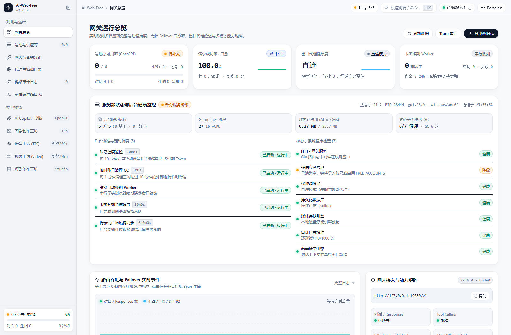
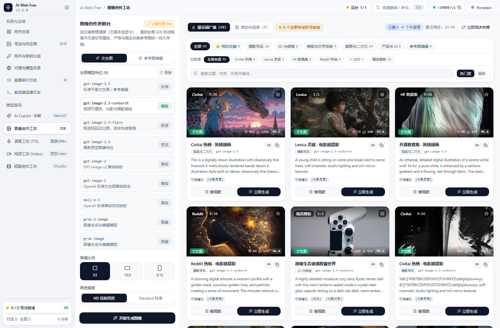
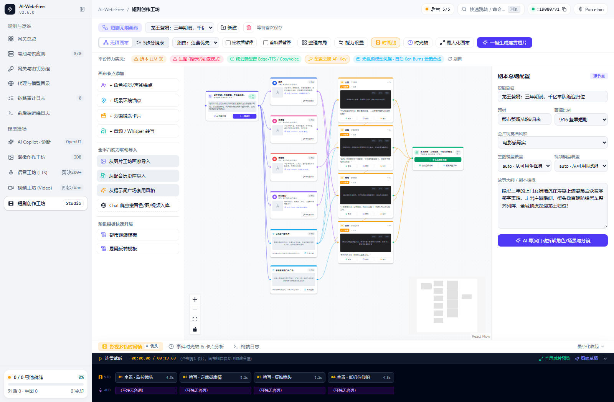

# AI Web Free

AI Web Free is a self-hosted, OpenAI-compatible multi-provider gateway and AI workbench. It brings chat and multimodal APIs together with account-pool operations, proxy scheduling, and tools for image, voice, and video creation.

## Highlights

- **One familiar API across multiple capabilities**: OpenAI-style Chat Completions, Responses, Tool Calling, file Q&A, image generation and editing, speech synthesis, and transcription. Exact capabilities depend on the configured provider and accounts.
- **Account-pool scheduling for long-running use**: Multiple credential sources, account deduplication, health checks, tiered cooldowns, token renewal, sticky proxies, and per-account TLS fingerprints. Request failover completes before response headers or the first SSE event are written.
- **Gateway operations in one console**: Inspect providers and account pools, proxies and model catalogs, gateway keys, request audit trails, and background task status without stitching together separate scripts.
- **An integrated creation workbench**: Includes a Copilot with scoped OpenUI dashboards, plus image, TTS, video, and short-drama studios. The drama canvas can orchestrate script, storyboard, audio, and video tasks.
- **Simple deployment**: The React console and system prompt are embedded in a zero-CGO Go binary. The target host does not need Node.js, npm, or Nginx.

## Screenshots

These screenshots come from a local demo instance and contain no real accounts or tokens. The console brings gateway health, multimodal creation, and visual workflows together.

**Gateway overview**: Inspect account pools, request success, proxies, and background health in one place.



**Image studio**: Select models, browse the prompt catalog, and manage generated works.



**Short-drama canvas**: Orchestrate scripts, storyboards, audio, and video tasks in a visual workflow.



## API Documentation

For full endpoints, authentication, token exchange, and curl examples, see: [API.md](API.md)

## Features

- OpenAI-style `/v1/chat/completions` with streaming and non-streaming support, including parameters such as `temperature`/`top_p`/`max_tokens`/`stop`/`reasoning_effort`/`response_format`/`stream_options.include_usage`.
- Tool Calling emulation — ChatGPT Web does not natively support function calling. AI Web Free emulates it via a `<tool_call>` text protocol, supporting `tools`/`tool_choice` fields, automatically injecting the calling convention into the system prompt and parsing `<tool_call>` blocks in model output into standard OpenAI-format `tool_calls`.
- OpenAI-style `/v1/responses` with string input, message arrays, `instructions`, streaming events, `previous_response_id` continuation, and Responses-format tool calling, plus parameters such as `reasoning.effort`/`text.query.format`/`temperature`.
- `/v1/files` for file uploads; after uploading, you can include `file_id` in chat or Responses requests for file-based Q&A.
- `/v1/images/generations` for image generation; the model list includes `gpt-image-2`, supports SSE streaming, and can return either URLs or `b64_json`.
- `/v1/images/edits` for image editing and `/v1/images/variations` for image-to-image generation (variations).
- `/v1/audio/speech` for text-to-speech (TTS), compatible with common OpenAI voices and output formats.
- `/v1/audio/transcriptions` for speech-to-text, supporting mp3/wav/m4a/ogg/flac/webm formats.
- `/v1/audio/translations` for audio translation into English.
- `/v1/models` for model listing.
- `/auth/refresh`: pass an OpenAI `refresh_token` to obtain an `access_token`.
- `/auth/session`: pass a ChatGPT `session_token` to obtain a new `session_token` and `access_token`.
- `/backend-api/conversation` for direct proxying of raw ChatGPT conversation requests.

- Support for `access_tokens.txt` account pool, `free_tokens.txt` free UUID pool, `refresh_tokens.txt` OAuth refresh token pool, `session_tokens.txt` session token pool, automatic free account generation, proxy pool, and TLS.
- **Full account management**: Each account has an independent TLS Client, proxy IP, browser fingerprint, and WSS connection. Supports 3 account types (TypeNoAuth / TypeFree / TypePUID) and 6 lifecycle states.
- **Token deduplication**: Deduplicates accounts by parsing `chatgpt_account_id` from the JWT payload — the same account won't occupy the pool twice even if multiple tokens are provided.
- **Capability system**: 10 capabilities (Chat / Responses / ToolCalling / ImageGenerate / ImageEdit / ImageVariation / TTS / Transcribe / FileUpload / WebSocket). Only chat/responses are accessible to noauth accounts; others require login.
- **Health check**: Automatically renews expired `session_token` / `refresh_token` accounts every 10 minutes.
- **External access_token support**: When `ENABLE_EXTERNAL_TOKEN=true`, accept externally provided ChatGPT access_tokens. Temporary isolated accounts (TLS Client + UA + proxy + fingerprint) are created and released after 10 minutes of inactivity.
## Deployment & Local Startup

### Build from source (Local)

```bash
# 1. Build frontend assets (embedded into the Go binary via go:embed)
cd web
npm ci
npx tsc --noEmit
npm run build
cd ..

# 2. Build static Go binary and run
CGO_ENABLED=0 go build -o ai-web-free .
./ai-web-free
# Or specify another port if 18080 is in use:
# SERVER_PORT=19080 ./ai-web-free
```

### Production Deployment & Tiered Storage Disaster Recovery

> 📖 For comprehensive production deployment, systemd service configuration, and disaster recovery guide, see: [docs/deployment-guide.md](docs/deployment-guide.md)

#### 1. Pure Static Single-Binary Deployment (Recommended)

The frontend React/TypeScript UI and system prompt are embedded directly into a single Go binary (`//go:embed`). **Target servers do not require Node.js, npm, or Nginx**:

```bash
# 1. Build Linux 64-bit pure static binary
cd web && npm run build && cd ..
CGO_ENABLED=0 GOOS=linux GOARCH=amd64 go build -ldflags="-s -w" -o ai-web-free .

# 2. Upload ai-web-free and .env to server and run (default port 18080)
chmod +x ai-web-free
./ai-web-free
```

#### 2. Qiniu Cloud Tiered Storage & Cross-Machine Disaster Recovery

The service provides a **Local Disk (Tier-1 Cache) + Qiniu Kodo (Tier-2 Cloud Storage)** architecture:
- **Generated Assets**: Saved to `./data/` instantly and asynchronously backed up to Qiniu Cloud.
- **Client Access**: Read-through caching: missing historical assets are automatically fetched from Qiniu and cached locally on demand.
- **Backup & Restore**:
  ```bash
  # Standalone binary subcommands
  ./ai-web-free restore     # Restore SQLite DB and .env from Qiniu Cloud
  ./ai-web-free backup      # Sync and backup SQLite DB and media to Qiniu Cloud

  # Source code shortcuts
  make restore              # Equivalent to make sync-pull
  make backup               # Equivalent to make sync-push
  ```
- **Automatic Cold-Start Recovery**: When deploying to a fresh server with no local SQLite database, configuring Qiniu credentials will automatically restore the latest database snapshot upon first startup!

### Docker

```bash
docker build -t ai-web-free:latest .
docker run -d \
  --name ai-web-free \
  -p 18080:18080 \
  -v $(pwd)/.env:/app/.env:ro \
  -v $(pwd)/data:/app/data \
  -v $(pwd)/access_tokens.txt:/access_tokens.txt:ro \
  ai-web-free:latest
```

> Prepare `access_tokens.txt` in the current directory (one access_token per line) and mount it into the container via `-v`. The same applies to other files: `-v $(pwd)/free_tokens.txt:/free_tokens.txt:ro`, `-v $(pwd)/proxies.txt:/proxies.txt:ro`.

### Docker Compose

```bash
# 1. Prepare .env and access_tokens.txt
# 2. Launch with docker-compose
docker-compose up -d --build
```

## Configuration

No additional configuration is required by default. You can configure via `.env`, system environment variables, or environment variables with the same name on your deployment platform:

```env
# Server listen
SERVER_HOST=0.0.0.0
SERVER_PORT=18080
PORT=18080

# Authentication
Authorization=your_authorization

# Free accounts
FREE_ACCOUNTS=true
FREE_ACCOUNTS_NUM=1024

# HTTPS
TLS_CERT=path_to_your_tls_cert
TLS_KEY=path_to_your_tls_key

# Proxy
PROXY_URL=your_proxy_url
http_proxy=

# Reverse proxy for specific endpoints (optional)
API_REVERSE_PROXY=
FILES_REVERSE_PROXY=

# Custom BASE_URL (default https://chatgpt.com/backend-api)
BASE_URL=

# Stream mode (set to false to force non-streaming Chat Completions)
STREAM_MODE=true

# Preserve conversation history context (set to true to enable)
ENABLE_HISTORY=false

# Tool calling emulation
TOOL_CALLING_ENABLED=true
REFUSAL_RETRIES=3
# DEBUG_TOOL_LOG=tool_debug.log

# External access token (accept ChatGPT access_token from request header)
ENABLE_EXTERNAL_TOKEN=true

# Qiniu Cloud Object Storage & Tiered Cache (disaster recovery & media backup)
QINIU_ACCESS_KEY=your_qiniu_access_key
QINIU_SECRET_KEY=your_qiniu_secret_key
QINIU_BUCKET=ai-web-free-storage
QINIU_DOMAIN=your_bucket_domain.clouddn.com
QINIU_REGION=z0
QINIU_UPLOAD_URL=https://upload.qiniup.com
```

Details:

- `SERVER_HOST` / `SERVER_PORT`: Service listening address and port. `PORT` is a fallback for `SERVER_PORT`.
- `Authorization`: Service access key. When configured, requests must include `Authorization: Bearer your_authorization` in the header.
- `QINIU_*`: Qiniu Cloud object storage credentials. Automatically activates the **Tiered Storage Engine**, media async backup, read-through caching, and cold-start SQLite auto-restore.
- `DATABASE_URL`: SQLite/MySQL/PostgreSQL connection string. Defaults to `data/ai-web-free.db`.
- `STORAGE_DIR`: Local tier-1 storage directory. Defaults to `data/storage`.
- `FREE_ACCOUNTS`: Whether to automatically generate free UUID accounts; disabled by default.
- `FREE_ACCOUNTS_NUM`: Number of automatically generated free UUID accounts; default is 1024.
- `TLS_CERT` / `TLS_KEY`: When both are configured, HTTPS is enabled.
- `PROXY_URL`: Proxy pool address. `http_proxy` is the fallback proxy address.
- `API_REVERSE_PROXY` / `FILES_REVERSE_PROXY`: Configure separate forward proxies for `/backend-api/*` and `/files` endpoints respectively; falls back to the default proxy when not set.
- `BASE_URL`: Custom upstream ChatGPT API base URL, defaults to `https://chatgpt.com/backend-api`.
- `STREAM_MODE`: Set to `false` to force non-streaming Chat Completions; defaults to `true`.
- `ENABLE_HISTORY`: Set to `true` to preserve conversation history context in requests.
- `TOOL_CALLING_ENABLED`: Set to `false` to ignore the `tools` field in requests and disable tool calling emulation.
- `REFUSAL_RETRIES`: Maximum retry attempts when the model enters a "sandbox refusal" loop; defaults to `3`.
- `ENABLE_EXTERNAL_TOKEN`: When set to `true`, accept externally provided ChatGPT access_tokens. A temporary account (with isolated TLS Client, UA, proxy, and browser fingerprint) is created per token, automatically released after 10 minutes of inactivity. Default `true`.
- `DEBUG_TOOL_LOG`: Set to a file path to write detailed trace logs for each tool call parsing (for debugging).

Local account files:

- `access_tokens.txt`: One ChatGPT `access_token` per line, used for features that require a logged-in account.
- `free_tokens.txt`: One UUID device ID per line, serving as a free account pool.
- `refresh_tokens.txt`: One OpenAI `refresh_token` per line (supports `token:team_id` format). Automatically exchanged for an `access_token` on startup; auto-renewed on expiry.
- `session_tokens.txt`: One ChatGPT `session_token` per line (supports `token:team_id` format). Automatically exchanged for an `access_token` on startup; auto-renewed on expiry.
- `proxies.txt`: One proxy URL per line (port required). Forms a proxy pool with `PROXY_URL`.
## License

MIT License
