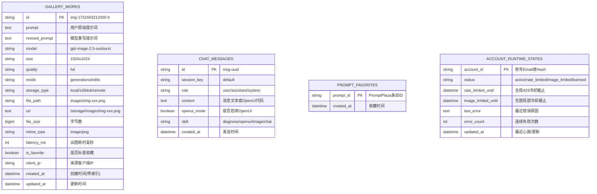

# ADR-0007: 当前项目使用了很多临时数据库，应该更改为持久化数据库，比如 图片工坊里我的作品，换浏览器后就没有了

<!-- grill-me-session: ba98a1e1-f145-4fe3-8214-52f2568d0893:0 -->
<!-- grill-me-topic-hash: d5b187cf68f5 -->

| 字段 | 内容 |
| :--- | :--- |
| 状态 | Accepted |
| 日期 | 2026-11-14 |
| 来源会话 | `ba98a1e1-f145-4fe3-8214-52f2568d0893` (step `0`) |
| 触发方式 | `/grill-me` 架构访谈自动归档 |

## 1. 背景与问题定义 (Context & Problem Statement)

- **原始 `/grill-me` 诉求**：/grill-me-adr 当前项目使用了很多临时数据库，应该更改为持久化数据库，比如 图片工坊里我的作品，换浏览器后就没有了

## 2. 决策树访谈记录 (Decision Drivers & Grill-Me Q&A)

#### 决策分支 1（单选）：持久化数据库引擎选型：在必须保持「严格零 CGO、纯静态编译、可单文件无外部依赖运行」的核心约束下，你倾向于使用哪种数据库方案？

候选方案：
- (Recommended) 纯 Go SQLite（modernc.org/sqlite）：严格零 CGO、单文件（如 data/ai-web-free.db），具备完整 SQL 索引与高效分页，环境受限或无写入权限时可优雅降级为 :memory: 内存模式
- 纯 Go 嵌入式 KV 引擎（go.etcd.io/bbolt）：极致轻量、单文件落盘、零外部依赖与零 CGO，由后端自行维护二级索引与键值序列化
- 多驱动统一抽象（纯 Go SQLite + PostgreSQL / MySQL）：默认纯 Go SQLite 本地单文件，同时支持通过 DATABASE_URL 外接外部数据库以适配集群部署
- 极简目录与 JSONL 存储（如 data/images/*.png + JSONL 索引）：不引入复杂 DB 依赖，延续现有 audit/ring 和 accounts/store 的纯文件风格

> **已选决策**：多驱动统一抽象（纯 Go SQLite + PostgreSQL / MySQL）：默认纯 Go SQLite 本地单文件，同时支持通过 DATABASE_URL 外接外部数据库以适配集群部署

#### 决策分支 2（单选）：图片二进制文件（每张 1~3MB PNG）的存储介质与访问方案：你希望如何管理这些生图文件本身？

候选方案：
- (Recommended) 本地磁盘文件目录（data/storage/images/{id}.png）+ 数据库存元数据：后端提供静态资源托管与安全访问，数据库保持极小体积与高查询性能
- 数据库内二进制直接存储（Blob 字段）：将图片 PNG 与元数据存在同一个数据库单文件中，备份只需复制一个 .db 文件，但出图多时数据库文件会迅速膨胀至数 GB
- 混合分层存储（本地磁盘优先 + 可选 S3 / R2 / MinIO 兼容对象存储插件）：单机默认写本地磁盘，配置 S3 环境变量时自动将生图异步上传到对象存储桶

> **已选决策**：混合分层存储（本地磁盘优先 + 可选 S3 / R2 / MinIO 兼容对象存储插件）：单机默认写本地磁盘，配置 S3 环境变量时自动将生图异步上传到对象存储桶

#### 决策分支 3（多选）：本次持久化改造的业务范围与数据平滑迁移策略：你希望将哪些目前处于“临时状态”的数据纳入持久化？

候选方案：
- (Recommended) 图像工坊「我的作品」画廊：提供作品持久化保存、按时间/模型/尺寸分页检索、收藏与批量删除 API
- (Recommended) 前端存量作品一键迁移：检测到当前浏览器 IndexedDB 中有存量历史作品时，在 UI 提供「一键同步上云/上传至服务端」无损迁移通道
- (Recommended) AI Copilot 诊断对话与提示词广场收藏：将 /chat 历史会话与提示词广场收藏一并迁移至服务端持久化，跨浏览器无缝同步
- 后端账号与节点运行状态持久化：将账号限流冷却时间、封禁状态、临时免密账号等生命周期也持久化入库，重启不丢失冷却上下文

> **已选决策**：(Recommended) 图像工坊「我的作品」画廊：提供作品持久化保存、按时间/模型/尺寸分页检索、收藏与批量删除 API, (Recommended) 前端存量作品一键迁移：检测到当前浏览器 IndexedDB 中有存量历史作品时，在 UI 提供「一键同步上云/上传至服务端」无损迁移通道, (Recommended) AI Copilot 诊断对话与提示词广场收藏：将 /chat 历史会话与提示词广场收藏一并迁移至服务端持久化，跨浏览器无缝同步, 后端账号与节点运行状态持久化：将账号限流冷却时间、封禁状态、临时免密账号等生命周期也持久化入库，重启不丢失冷却上下文

#### 决策分支 4（单选）：作品与会话的多用户与数据隔离模型：在跨浏览器共享时，你希望如何界定数据归属与权限边界？

候选方案：
- (Recommended) 团队统一共享工作台（单租户/管理员空间）：以 ADMIN_TOKEN 作为安全边界，所有通过管理台登录的设备共享同一个画廊与对话库，每张作品附带来源 IP / 客户端标识，适合个人或私有化小团队使用
- 基于用户标识/工作空间的多隔离模式（Workspace / User-ID）：默认提供 Default 空间，同时允许在前端或请求头指定 workspace_id / user_id 划分个人专属作品集与对话历史
- 双层访问模型：公开 API 生成的作品归属于对应的 API Key / Client-ID，管理台超级管理员可查看全平台所有作品与审计全景

> **已选决策**：(Recommended) 团队统一共享工作台（单租户/管理员空间）：以 ADMIN_TOKEN 作为安全边界，所有通过管理台登录的设备共享同一个画廊与对话库，每张作品附带来源 IP / 客户端标识，适合个人或私有化小团队使用

#### 决策分支 5（单选）：后端多数据库接入的技术实现与 ORM 选型：你倾向于采用哪种 Go 数据库抽象层？

候选方案：
- (Recommended) GORM 纯 Go 驱动生态（gorm.io/gorm + modernc.org/sqlite + pgx + mysql）：成熟可靠，支持 AutoMigrate 自动建表与表结构升级，严格零 CGO，一套数据模型无缝适配 SQLite / Postgres / MySQL
- 标准库 database/sql + 纯 Go 驱动（modernc.org/sqlite 等）+ 轻量手写适配层：不引入完整 ORM，纯手工控制 SQL 与方言差异，极其透明精简，但需要手写多数据库迁移 DDL
- sqlx + 纯 Go 多驱动：提供轻量结构体扫描与简单 SQL 增强，兼顾性能与简易性

> **已选决策**：(Recommended) GORM 纯 Go 驱动生态（gorm.io/gorm + modernc.org/sqlite + pgx + mysql）：成熟可靠，支持 AutoMigrate 自动建表与表结构升级，严格零 CGO，一套数据模型无缝适配 SQLite / Postgres / MySQL

#### 决策分支 6（单选）：浏览器存量本地数据（IndexedDB 中的作品与对话）迁移时的前端交互体验：你期望如何引导用户同步历史数据？

候选方案：
- (Recommended) 顶部提示横幅 + 一键确认迁移（NoticeBanner）：检测到本地 IndexedDB 有存量旧数据时提示「检测到本地存在 N 个历史作品与对话，点击一键同步到服务端数据库」，迁移完成后可选择保留或清理本地缓存
- 静默自动后台无感同步：只要连上后端，前端自动在后台静默将本地 IndexedDB 补推到服务端数据库，完成本地与远端合并
- 仅在设置/工坊中提供手动「导出至服务端」按钮：不主动弹窗打扰用户，用户有需要时自行在画廊设置中点击迁移

> **已选决策**：(Recommended) 顶部提示横幅 + 一键确认迁移（NoticeBanner）：检测到本地 IndexedDB 有存量旧数据时提示「检测到本地存在 N 个历史作品与对话，点击一键同步到服务端数据库」，迁移完成后可选择保留或清理本地缓存

## 3. 已收敛的架构决策摘要 (Confirmed Decisions Summary)

- **决策 1**：持久化数据库引擎选型：在必须保持「严格零 CGO、纯静态编译、可单文件无外部依赖运行」的核心约束下，你倾向于使用哪种数据库方案？ → **多驱动统一抽象（纯 Go SQLite + PostgreSQL / MySQL）：默认纯 Go SQLite 本地单文件，同时支持通过 DATABASE_URL 外接外部数据库以适配集群部署**
- **决策 2**：图片二进制文件（每张 1~3MB PNG）的存储介质与访问方案：你希望如何管理这些生图文件本身？ → **混合分层存储（本地磁盘优先 + 可选 S3 / R2 / MinIO 兼容对象存储插件）：单机默认写本地磁盘，配置 S3 环境变量时自动将生图异步上传到对象存储桶**
- **决策 3**：本次持久化改造的业务范围与数据平滑迁移策略：你希望将哪些目前处于“临时状态”的数据纳入持久化？ → **(Recommended) 图像工坊「我的作品」画廊：提供作品持久化保存、按时间/模型/尺寸分页检索、收藏与批量删除 API, (Recommended) 前端存量作品一键迁移：检测到当前浏览器 IndexedDB 中有存量历史作品时，在 UI 提供「一键同步上云/上传至服务端」无损迁移通道, (Recommended) AI Copilot 诊断对话与提示词广场收藏：将 /chat 历史会话与提示词广场收藏一并迁移至服务端持久化，跨浏览器无缝同步, 后端账号与节点运行状态持久化：将账号限流冷却时间、封禁状态、临时免密账号等生命周期也持久化入库，重启不丢失冷却上下文**
- **决策 4**：作品与会话的多用户与数据隔离模型：在跨浏览器共享时，你希望如何界定数据归属与权限边界？ → **(Recommended) 团队统一共享工作台（单租户/管理员空间）：以 ADMIN_TOKEN 作为安全边界，所有通过管理台登录的设备共享同一个画廊与对话库，每张作品附带来源 IP / 客户端标识，适合个人或私有化小团队使用**
- **决策 5**：后端多数据库接入的技术实现与 ORM 选型：你倾向于采用哪种 Go 数据库抽象层？ → **(Recommended) GORM 纯 Go 驱动生态（gorm.io/gorm + modernc.org/sqlite + pgx + mysql）：成熟可靠，支持 AutoMigrate 自动建表与表结构升级，严格零 CGO，一套数据模型无缝适配 SQLite / Postgres / MySQL**
- **决策 6**：浏览器存量本地数据（IndexedDB 中的作品与对话）迁移时的前端交互体验：你期望如何引导用户同步历史数据？ → **(Recommended) 顶部提示横幅 + 一键确认迁移（NoticeBanner）：检测到本地 IndexedDB 有存量旧数据时提示「检测到本地存在 N 个历史作品与对话，点击一键同步到服务端数据库」，迁移完成后可选择保留或清理本地缓存**

## 4. 落地方案与影响范围 (Implementation Plan & Consequences)

# 生产级多驱动持久化数据库与全局图像工坊/会话存储规范

## 1. 设计目标与背景 (Context & Objectives)

在当前版本中，AI-Web-Free 平台的大部分用户态与运行时数据依赖于浏览器的本地存储（IndexedDB / LocalStorage）或 Go 内存结构：
- **痛点 1（用户直观体验）**：图像工坊（ImageStudio）生成的作品仅以二进制 Blob 形式暂存于浏览器本地 IndexedDB（`ai_web_free_studio_db` 中的 `images` 表）。用户更换浏览器、切换设备、开启无痕模式或清理浏览器缓存后，作品全部丢失。
- **痛点 2（对话历史与收藏丢失）**：AI Copilot 诊断对话记录（`chats` 表）与提示词广场收藏（LocalStorage `ai_web_free_fav_prompts_v1`）同样受限于单机浏览器沙箱，无法跨端同步。
- **痛点 3（后端运行态重置）**：号池节点遭遇 429 或生图限流后的冷却截至时间（`CooldownUntil` / `ImageCooldownUntil`）、封禁标记与临时生成的免密设备账号仅存放在 Go 运行时内存中，服务重启后丢失冷却上下文。

### 1.1 核心工程约束闭环 (Constraints)

1. **严格零 CGO 与纯静态编译（`CGO_ENABLED=0`）**：
   - 生产镜像基于 `gcr.io/distroless/static-debian12:nonroot`，禁止引入任何 CGO 绑定（如 `mattn/go-sqlite3`）。
   - SQLite 必须使用纯 Go 实现驱动（如 `github.com/glebarez/sqlite` / `modernc.org/sqlite`）。
2. **多驱动统一抽象与无感降级**：
   - 默认模式：开箱即用，单文件 SQLite 本地落盘（默认路径 `data/ai-web-free.db`）。
   - 企业级集群模式：支持配置 `DATABASE_URL`（如 `postgres://...` 或 `mysql://...`），适配外部高可用数据库。
   - 无盘/只读容器兼容：当运行在未挂载持久卷且文件系统只读的无根容器时，支持自动降级或显式配置 `:memory:` 纯内存数据库，绝不因目录无写权限导致 panic。
3. **混合分层存储引擎（Hybrid Storage Engine）**：
   - 针对单张 1~3MB 的 PNG 图片文件，避免数据库文件急剧膨胀，采用「文件系统/对象存储放二进制，数据库仅存结构化元数据」的经典架构。
   - 默认本地磁盘优先（`data/storage/images/{id}.png`），由 Gin 路由统一托管分发；
   - 可选 S3 兼容对象存储插件（AWS S3 / Cloudflare R2 / MinIO），配置对应环境变量时自动无感接入。
4. **平滑迁移与前端存量兼容**：
   - 针对已有用户浏览器 IndexedDB 中的历史存量作品，提供非破坏性的顶部引导横幅（NoticeBanner），支持一键批量上报/同步到服务端数据库。

---

## 2. 数据库架构与数据模型设计 (Data Models & Schema)

采用 **GORM 纯 Go 生态（`gorm.io/gorm`）** 配合纯 Go 驱动（SQLite / Postgres / MySQL），利用 `db.AutoMigrate(...)` 在服务启动时自动完成表结构建表与安全平滑升级。



### 2.1 图像工坊作品表 (`gallery_works`)

```go
type GalleryWork struct {
    ID            string    `gorm:"primaryKey;size:64" json:"id"`
    Prompt        string    `gorm:"type:text;not null" json:"prompt"`
    RevisedPrompt string    `gorm:"type:text" json:"revised_prompt,omitempty"`
    Model         string    `gorm:"size:64;index" json:"model"`
    Size          string    `gorm:"size:32" json:"size"`
    Quality       string    `gorm:"size:32" json:"quality,omitempty"`
    Mode          string    `gorm:"size:32;default:'generations'" json:"mode"`
    StorageType   string    `gorm:"size:32;default:'local'" json:"storage_type"` // local, s3, blob, remote
    FilePath      string    `gorm:"size:255" json:"file_path,omitempty"`
    URL           string    `gorm:"type:text;not null" json:"url"`
    BlobData      []byte    `gorm:"type:blob" json:"-"`                          // 仅在无磁盘模式下作为纯内存/库内兜底
    FileSize      int64     `json:"file_size"`
    MimeType      stri

...（节选，完整内容见原始记录）

### 关联原型与规范产物

- `persistent-database-and-gallery.md`（`/home/luwei/workspace/github/ai-web-free/openspec/specs/storage/persistent-database-and-gallery.md`）
