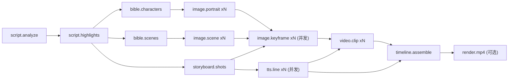

# ADR-0012: 当前短剧工坊有些问题

<!-- grill-me-session: 831871ec-9a6b-4088-b8f4-c4828edcb31e:0 -->
<!-- grill-me-topic-hash: e5628d5f4010 -->

| 字段 | 内容 |
| :--- | :--- |
| 状态 | Accepted |
| 日期 | 2026-11-16 |
| 来源会话 | `831871ec-9a6b-4088-b8f4-c4828edcb31e` (step `0`) |
| 触发方式 | `/grill-me` 架构访谈自动归档 |

## 1. 背景与问题定义 (Context & Problem Statement)

- **原始 `/grill-me` 诉求**：/grill-me 当前短剧工坊有些问题，无法一次成片，我的原始想法是这样的，工坊一个剧本，工坊在后台自动拆剧本，提取精彩关键镜头剧情，分镜，人物设定，自动调用 生图生成设定图和场景图等，分镜，后续根据无聊调用 视频组件生成完整的短剧，现在的情况是只打通了部分环节，一些环节依然有问题无法成片，例如性能问题，一些环节是可以根据并发执行的，比如 生图环节，我们的生图账号是账号池组成的，完全可以并发生成设定图和分镜的，另外短剧工程是如何保存的，是否是json 格式，另外短剧各个节点是否有状态保护，当重复触发一键短剧时，准备好的节点可以跳过，短剧工程如果是/结构化，那么通过agent 也可以自由编排，这个是卖点

## 2. 决策树访谈记录 (Decision Drivers & Grill-Me Q&A)

#### 决策分支 1（单选）：Q1: Where should the pipeline run? Today it runs in the browser, so closing the page stops it. Background splitting, account-pool concurrency, and agent orchestration all point toward a backend engine.

候选方案：
- (Recommended) Move to a backend Go DAG engine: the server runs the nodes, the frontend only shows status (SSE/polling) and edits the project, and an agent calls the same API
- Keep the frontend orchestrator and only improve concurrency and skip logic (small change, but no background runs and no real agent orchestration)
- Hybrid: backend handles the image/TTS/video calls, frontend keeps the scheduling

> **已选决策**：使用中文回复问题

#### 决策分支 2（单选）：Q1: Where should the short-drama pipeline run? Background script splitting, account-pool concurrency, and free agent orchestration all need it to run on the server.

候选方案：
- (Recommended) Move to a backend Go DAG engine: the server runs nodes and saves state, the frontend only shows progress (SSE) and edits the project, and agents/MCP call the same API
- Keep the frontend orchestrator and only improve concurrency and skipping (small change, but closing the page still stops the run and agents can't orchestrate)
- Hybrid: backend runs the long tasks (image/video), frontend keeps the scheduling

> **已选决策**：_待用户确认 / 进行中_

#### 决策分支 3（单选）：Q1：短剧流水线由谁来执行？要做到后台自动拆剧本、按账号池并发、Agent 自由编排，基本都得放到服务端。

候选方案：
- （推荐）迁到后端 Go DAG 引擎：服务端执行节点并持久化状态，前端只负责展示进度（SSE）和编辑工程，Agent/MCP 调用同一套 API
- 保留前端编排，只优化并发和跳过逻辑（改动小，但关掉页面就中断，Agent 也没法编排）
- 混合：耗时任务（生图/视频）交给后端队列，调度仍留在前端

> **已选决策**：（推荐）迁到后端 Go DAG 引擎：服务端执行节点并持久化状态，前端只负责展示进度（SSE）和编辑工程，Agent/MCP 调用同一套 API

#### 决策分支 4（单选）：Q2：短剧工程怎么存？现在存的 graph_json 是画布节点结构，里面混着坐标和 UI 字段，Agent 很难理解和修改。

候选方案：
- （推荐）领域 JSON 作为唯一事实源：定义版本化的 DramaProject Schema（script / characters / scenes / shots / assets / tasks），整体存 DB 的 JSON 列并带 revision 乐观锁；画布坐标等 UI 信息单独存 layout，画布由 Schema 派生
- 领域模型拆成关系表（drama_characters / drama_shots / drama_tasks ...），导出时再拼成 JSON
- 继续用现有 React Flow graph_json，只在后端解析节点

> **已选决策**：（推荐）领域 JSON 作为唯一事实源：定义版本化的 DramaProject Schema（script / characters / scenes / shots / assets / tasks），整体存 DB 的 JSON 列并带 revision 乐观锁；画布坐标等 UI 信息单独存 layout，画布由 Schema 派生

#### 决策分支 5（单选）：Q3：重复触发一键短剧时，怎么判断一个节点可以跳过？

候选方案：
- （推荐）输入指纹：每个产物节点记录 input_hash（由 prompt、模型、上游产物 hash 等算出），状态是 ready 且 hash 一致就跳过；上游一变就把下游标为 stale 并重新计算；另加 locked 标记，用户确认满意的产物永不覆盖
- 只看状态：ready 就跳过，需要重做时由用户手动点重生成（简单，但改了角色外貌，分镜不会自动更新）
- 先只看状态，之后再加 hash

> **已选决策**：（推荐）输入指纹：每个产物节点记录 input_hash（由 prompt、模型、上游产物 hash 等算出），状态是 ready 且 hash 一致就跳过；上游一变就把下游标为 stale 并重新计算；另加 locked 标记，用户确认满意的产物永不覆盖

#### 决策分支 6（单选）：Q4：生图怎么并发？现在分镜首帧是串行的，因为每一镜都要拿上一镜的图做参考。

候选方案：
- （推荐）去掉「前一镜」硬依赖：分镜首帧只依赖角色设定图和场景图，等设定图全部 ready 后，所有分镜全并发；并发上限 = 可用生图账号数（全局信号量 + 可配置上限），TTS 与生图并行；只对标记了「连续镜头」的镜头保留前镜参考
- 保持前镜参考，按场景分组：组内串行、组间并发
- 全部并发，不设上限，让账号池自己去排队

> **已选决策**：（推荐）去掉「前一镜」硬依赖：分镜首帧只依赖角色设定图和场景图，等设定图全部 ready 后，所有分镜全并发；并发上限 = 可用生图账号数（全局信号量 + 可配置上限），TTS 与生图并行；只对标记了「连续镜头」的镜头保留前镜参考

#### 决策分支 7（单选）：Q5：节点失败了怎么处理？现在是一张图失败，整条流水线就中断。

候选方案：
- （推荐）节点级隔离：单个节点失败不中断整个 Run；每个节点自动重试 N 次（指数退避，换账号），失败产物按规则降级（视频失败→Ken Burns，参考图编辑失败→文生图）；只阻塞依赖它的下游；Run 结束时状态为 completed / partial / failed，再触发一次只补失败的节点
- 任一节点失败就中止整个 Run，交给用户处理
- 只重试，不降级

> **已选决策**：（推荐）节点级隔离：单个节点失败不中断整个 Run；每个节点自动重试 N 次（指数退避，换账号），失败产物按规则降级（视频失败→Ken Burns，参考图编辑失败→文生图）；只阻塞依赖它的下游；Run 结束时状态为 completed / partial / failed，再触发一次只补失败的节点

#### 决策分支 8（单选）：Q6：最后一公里怎么出片？受限于 CGO_ENABLED=0 + distroless，后端没有 ffmpeg；现在是前端 Canvas+MediaRecorder 实时录制合成。

候选方案：
- （推荐）分两层：后端的终点节点产出「时间线 timeline.json + 素材 + 字幕 + 剪映草稿」，这一步就算成片；合成 MP4 是可选的 render 节点，由可配置的外部 ffmpeg 渲染服务（RENDER_SERVICE_URL，docker compose profile 提供）完成；没配置时回退到前端 Canvas+MediaRecorder 合成
- 只保留前端合成（需要打开浏览器，实时录制、速度慢）
- 纯 Go 实现 MP4 拼接（只能拼编码一致的片段，Ken Burns 没法编码，风险高）

> **已选决策**：（推荐）分两层：后端的终点节点产出「时间线 timeline.json + 素材 + 字幕 + 剪映草稿」，这一步就算成片；合成 MP4 是可选的 render 节点，由可配置的外部 ffmpeg 渲染服务（RENDER_SERVICE_URL，docker compose profile 提供）完成；没配置时回退到前端 Canvas+MediaRecorder 合成

#### 决策分支 9（单选）：Q7：剧本怎么拆？现在是一次 LLM 调用直接出角色、场景和 4~6 个分镜，长剧本不好处理，也没有「提取精彩剧情」这一步。

候选方案：
- （推荐）多阶段：① 剧本分析（故事节拍、冲突点、爆点评分）→ ② 按目标时长/镜头数挑出高光节拍 → ③ 角色圣经与场景设定 → ④ 逐节拍分镜。每一步都是 DAG 节点，输出用 JSON Schema 校验，不合法就把校验错误回灌给模型修复重试；② 之后可以设检查点
- 保持单次 LLM 调用拆解，只加 Schema 校验和修复重试
- 两阶段：先分析并挑高光，再一次性生成角色、场景和分镜

> **已选决策**：（推荐）多阶段：① 剧本分析（故事节拍、冲突点、爆点评分）→ ② 按目标时长/镜头数挑出高光节拍 → ③ 角色圣经与场景设定 → ④ 逐节拍分镜。每一步都是 DAG 节点，输出用 JSON Schema 校验，不合法就把校验错误回灌给模型修复重试；② 之后可以设检查点

#### 决策分支 10（单选）：Q8：Agent 编排接口开放到什么程度？

候选方案：
- （推荐）固定节点类型库 + 可编排的工程：暴露 REST（GET 工程 / JSON Patch 修改 / run 指定节点或子图 / SSE 事件），再封装成 MCP 工具和内置 Chat 工具；Agent 可以增删镜头、改 prompt、锁定产物、指定重跑哪些节点，但节点类型和依赖规则由引擎定义
- 完全自定义 DAG：Agent 可以自己声明任意节点和连线（类似 ComfyUI 工作流）
- 先只提供 REST，MCP 以后再说

> **已选决策**：（推荐）固定节点类型库 + 可编排的工程：暴露 REST（GET 工程 / JSON Patch 修改 / run 指定节点或子图 / SSE 事件），再封装成 MCP 工具和内置 Chat 工具；Agent 可以增删镜头、改 prompt、锁定产物、指定重跑哪些节点，但节点类型和依赖规则由引擎定义

#### 决策分支 11（单选）：Q9：Run 的生命周期怎么定？（服务重启后怎么办、允不允许重复触发、Run 期间能不能编辑）

候选方案：
- （推荐）每个工程同时只能有一个活跃 Run（重复触发直接返回已有的 run_id，幂等）；节点状态和视频 task_id 实时落库，进程重启后把 running 的节点重置为 pending，已提交的视频任务按 task_id 继续轮询，然后自动续跑；Run 期间编辑工程只会把受影响的节点标成 stale，当前 Run 跳过正在执行的已失效结果，只计算尚未开始的节点
- 进程重启后把 Run 标为 interrupted，等用户手动重新触发；Run 期间工程只读
- 允许同一个工程并行跑多个 Run

> **已选决策**：（推荐）每个工程同时只能有一个活跃 Run（重复触发直接返回已有的 run_id，幂等）；节点状态和视频 task_id 实时落库，进程重启后把 running 的节点重置为 pending，已提交的视频任务按 task_id 继续轮询，然后自动续跑；Run 期间编辑工程只会把受影响的节点标成 stale，当前 Run 跳过正在执行的已失效结果，只计算尚未开始的节点

#### 决策分支 12（单选）：Q10：怎么迁移和分期落地？

候选方案：
- （推荐）分三期：P1 后端 Schema + DAG 引擎 + 并发生图/TTS + 跳过与连带失效，前端一键制片改调后端；P2 多阶段拆剧本 + 视频节点 + timeline/剪映草稿；P3 MCP/Chat 工具 + 外部渲染服务。旧 graph_json 在读取时自动转换成新 Schema（保留已生成的素材，按 ready 导入），前端 dramaOrchestrator 在 P1 完成后删除，IndexedDB 只用作缓存
- 一次性全部重写完再切换
- 新旧两套长期并存，用开关切换

> **已选决策**：（推荐）分三期：P1 后端 Schema + DAG 引擎 + 并发生图/TTS + 跳过与连带失效，前端一键制片改调后端；P2 多阶段拆剧本 + 视频节点 + timeline/剪映草稿；P3 MCP/Chat 工具 + 外部渲染服务。旧 graph_json 在读取时自动转换成新 Schema（保留已生成的素材，按 ready 导入），前端 dramaOrchestrator 在 P1 完成后删除，IndexedDB 只用作缓存

## 3. 已收敛的架构决策摘要 (Confirmed Decisions Summary)

- **决策 1**：Q1: Where should the pipeline run? Today it runs in the browser, so closing the page stops it. Background splitting, account-pool concurrency, and agent orchestration all point toward a backend engine. → **使用中文回复问题**
- **决策 3**：Q1：短剧流水线由谁来执行？要做到后台自动拆剧本、按账号池并发、Agent 自由编排，基本都得放到服务端。 → **（推荐）迁到后端 Go DAG 引擎：服务端执行节点并持久化状态，前端只负责展示进度（SSE）和编辑工程，Agent/MCP 调用同一套 API**
- **决策 4**：Q2：短剧工程怎么存？现在存的 graph_json 是画布节点结构，里面混着坐标和 UI 字段，Agent 很难理解和修改。 → **（推荐）领域 JSON 作为唯一事实源：定义版本化的 DramaProject Schema（script / characters / scenes / shots / assets / tasks），整体存 DB 的 JSON 列并带 revision 乐观锁；画布坐标等 UI 信息单独存 layout，画布由 Schema 派生**
- **决策 5**：Q3：重复触发一键短剧时，怎么判断一个节点可以跳过？ → **（推荐）输入指纹：每个产物节点记录 input_hash（由 prompt、模型、上游产物 hash 等算出），状态是 ready 且 hash 一致就跳过；上游一变就把下游标为 stale 并重新计算；另加 locked 标记，用户确认满意的产物永不覆盖**
- **决策 6**：Q4：生图怎么并发？现在分镜首帧是串行的，因为每一镜都要拿上一镜的图做参考。 → **（推荐）去掉「前一镜」硬依赖：分镜首帧只依赖角色设定图和场景图，等设定图全部 ready 后，所有分镜全并发；并发上限 = 可用生图账号数（全局信号量 + 可配置上限），TTS 与生图并行；只对标记了「连续镜头」的镜头保留前镜参考**
- **决策 7**：Q5：节点失败了怎么处理？现在是一张图失败，整条流水线就中断。 → **（推荐）节点级隔离：单个节点失败不中断整个 Run；每个节点自动重试 N 次（指数退避，换账号），失败产物按规则降级（视频失败→Ken Burns，参考图编辑失败→文生图）；只阻塞依赖它的下游；Run 结束时状态为 completed / partial / failed，再触发一次只补失败的节点**
- **决策 8**：Q6：最后一公里怎么出片？受限于 CGO_ENABLED=0 + distroless，后端没有 ffmpeg；现在是前端 Canvas+MediaRecorder 实时录制合成。 → **（推荐）分两层：后端的终点节点产出「时间线 timeline.json + 素材 + 字幕 + 剪映草稿」，这一步就算成片；合成 MP4 是可选的 render 节点，由可配置的外部 ffmpeg 渲染服务（RENDER_SERVICE_URL，docker compose profile 提供）完成；没配置时回退到前端 Canvas+MediaRecorder 合成**
- **决策 9**：Q7：剧本怎么拆？现在是一次 LLM 调用直接出角色、场景和 4~6 个分镜，长剧本不好处理，也没有「提取精彩剧情」这一步。 → **（推荐）多阶段：① 剧本分析（故事节拍、冲突点、爆点评分）→ ② 按目标时长/镜头数挑出高光节拍 → ③ 角色圣经与场景设定 → ④ 逐节拍分镜。每一步都是 DAG 节点，输出用 JSON Schema 校验，不合法就把校验错误回灌给模型修复重试；② 之后可以设检查点**
- **决策 10**：Q8：Agent 编排接口开放到什么程度？ → **（推荐）固定节点类型库 + 可编排的工程：暴露 REST（GET 工程 / JSON Patch 修改 / run 指定节点或子图 / SSE 事件），再封装成 MCP 工具和内置 Chat 工具；Agent 可以增删镜头、改 prompt、锁定产物、指定重跑哪些节点，但节点类型和依赖规则由引擎定义**
- **决策 11**：Q9：Run 的生命周期怎么定？（服务重启后怎么办、允不允许重复触发、Run 期间能不能编辑） → **（推荐）每个工程同时只能有一个活跃 Run（重复触发直接返回已有的 run_id，幂等）；节点状态和视频 task_id 实时落库，进程重启后把 running 的节点重置为 pending，已提交的视频任务按 task_id 继续轮询，然后自动续跑；Run 期间编辑工程只会把受影响的节点标成 stale，当前 Run 跳过正在执行的已失效结果，只计算尚未开始的节点**
- **决策 12**：Q10：怎么迁移和分期落地？ → **（推荐）分三期：P1 后端 Schema + DAG 引擎 + 并发生图/TTS + 跳过与连带失效，前端一键制片改调后端；P2 多阶段拆剧本 + 视频节点 + timeline/剪映草稿；P3 MCP/Chat 工具 + 外部渲染服务。旧 graph_json 在读取时自动转换成新 Schema（保留已生成的素材，按 ready 导入），前端 dramaOrchestrator 在 P1 完成后删除，IndexedDB 只用作缓存**

## 4. 落地方案与影响范围 (Implementation Plan & Consequences)

# 短剧工坊后端 DAG 引擎：访谈收敛方案

## 现状问题（基于代码核查）
| 问题 | 位置 |
| :--- | :--- |
| 编排在浏览器里跑，关掉页面就中断 | `web/src/lib/dramaOrchestrator.ts` |
| 工程存的是 React Flow `graph_json`，混着 UI 字段，Agent 难以理解 | `internal/db/models.go` `DramaProjectRecord` |
| 分镜首帧依赖前一镜，逐镜串行；视频也串行提交 | `runAutoDramaPipeline` L935、L965 |
| 跳过只看 `ready`，不看输入变化；重新拆剧本会替换整张图 | `runScriptBreakdownToCanvas` |
| `Promise.all` 里一个失败，整条流水线中断 | L918、L947 |
| 拆剧本只调一次 LLM，没有「提取高光剧情」 | L195 |

## 决策汇总
| # | 议题 | 决策 |
| :--- | :--- | :--- |
| Q1 | 执行位置 | 后端 Go DAG 引擎；前端通过 SSE 展示进度并编辑工程 |
| Q2 | 工程存储 | 版本化 `DramaProject` 领域 JSON 是唯一事实源（JSON 列 + `revision` 乐观锁）；`layout` 单独存，画布由 Schema 派生 |
| Q3 | 跳过 / 状态保护 | `input_hash` 指纹；上游变化时下游连带标记 `stale`；`locked` 的产物永不覆盖 |
| Q4 | 并发 | 分镜首帧只依赖角色/场景设定图，全部并发；全局信号量上限 = 可用生图账号数（可配置）；TTS 与生图并行；只有 `continuous` 镜头保留前镜参考 |
| Q5 | 失败处理 | 节点级隔离 + 指数退避重试并换账号 + 降级（视频→Ken Burns，图片编辑→文生图）；Run 结果为 `completed/partial/failed` |
| Q6 | 出片 | 终点节点产出 `timeline.json` + 素材 + SRT + 剪映草稿，到这一步就算成片；MP4 渲染为可选节点，走 `RENDER_SERVICE_URL` 外部 ffmpeg，未配置时回退前端合成 |
| Q7 | 拆剧本 | 剧本分析 → 挑高光节拍 → 角色/场景圣经 → 逐节拍分镜；每步做 JSON Schema 校验 + 修复重试；②之后可设检查点 |
| Q8 | Agent 接口 | 固定节点类型库；REST（GET / JSON Patch / 运行子图 / SSE）+ MCP + 内置 Chat 工具 |
| Q9 | Run 生命周期 | 每个工程只允许一个活跃 Run（幂等返回 `run_id`）；状态实时落库，重启后自动续跑并按 `task_id` 恢复视频轮询；Run 期间编辑只把受影响节点标为 `stale` |
| Q10 | 落地 | 分 P1 / P2 / P3 三期；旧 `graph_json` 读取时自动转换；P1 完成后删除前端编排器 |

## DAG 节点拓扑


## Schema 草案（`schema_version: 1`）
```jsonc
{
  "id": "drm_xxx", "schema_version": 1, "revision": 12,
  "script":   { "title": "", "outline": "", "genre": "", "aspect_ratio": "9:16", "style": "", "target_duration_sec": 60, "routing_policy": "free_first" },
  "analysis": { "beats": [{ "id": "b1", "summary": "", "conflict": "", "hook_score": 0.9 }], "highlight_beat_ids": ["b1"] },
  "characters": [{ "id": "c1", "name": "", "role": "", "appearance_bible": "", "voice": { "engine": "edge-tts", "id": "" }, "portrait": "<asset_ref>" }],
  "scenes":     [{ "id": "s1", "name": "", "environment": "", "lighting": "", "anchor": "<asset_ref>" }],
  "shots":      [{ "id": "sh1", "index": 1, "beat_id": "b1", "scene_id": "s1", "speaker_id": "c1", "continuous": false,
                   "shot_type": "", "camera_move": "", "action": "", "dialogue": "", "duration_sec": 4.5,
                   "keyframe": "<asset_ref>", "audio": "<asset_ref>", "video": "<asset_ref>" }],
  "assets":   { "<asset_id>": { "kind": "image|audio|video", "url": "/storage/...", "sha256": "", "model": "", "prompt": "" } },
  "nodes":    { "image.keyframe:sh1": { "status": "pending|running|ready|stale|failed|degraded", "input_hash": "", "output": "<asset_id>", "locked": false, "attempts": 0, "error": "", "task_id": "" } },
  "timeline": { "tracks": [], "srt": "" }
}
```
`layout`（画布坐标）放在单独的字段或表里，不进入 `input_hash` 计算。

## 后端接口（`/admin/api/v1/drama/*`）
- `GET /projects/:id`：读取 Schema；`PATCH /projects/:id`（RFC 6902 JSON Patch，需带 `If-Match: revision`）
- `POST /projects/:id/runs`：body `{ targets?: ["image.keyframe:*"], force?: [], until?: "timeline.assemble" }`，已有活跃 Run 时幂等返回
- `GET /projects/:id/runs/:rid/events`：SSE 推送 `node.update` / `run.update`
- `POST /projects/:id/nodes/:nodeKey/lock|unlock|retry`

## 分期
- **P1**：`internal/drama/`（schema、hash、DAG 调度、信号量、节点执行器：portrait / scene / keyframe / tts）+ 落库续跑 + SSE + 前端改调后端 + 旧 `graph_json` 迁移；删除 `dramaOrchestrator.ts`
- **P2**：多阶段拆剧本节点 + Schema 校验修复 + 视频节点（task_id 续轮询）+ `timeline.assemble` / 剪映草稿 / SRT
- **P3**：MCP / Chat 工具、`RENDER_SERVICE_URL` 渲染节点（docker compose profile）
- 每期完成后同步更新 `openspec/specs/workflow/short-drama-studio.md`

### 关联原型与规范产物

- `drama_engine_design.md`（`/home/luwei/.gemini/antigravity/brain/831871ec-9a6b-4088-b8f4-c4828edcb31e/drama_engine_design.md`）：短剧工坊后端 DAG 引擎 /grill-me 访谈收敛方案：现状问题、10 项决策、节点拓扑、Schema 草案、接口与 P1-P3 分期
