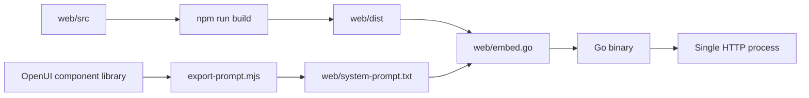

# 前端嵌入与发布

## 前端运行方式

管理台是 `web/` 下的 Vite + React + TypeScript 应用。`web/embed.go` 使用 `go:embed all:dist` 嵌入 `web/dist`，并嵌入 `web/system-prompt.txt`。Gin 在 `/`、`/index.html`、`/assets/*` 和 `/samples/*` 提供这些文件，API 与管理 UI 由同一 Go 进程服务。



OpenUI 组件仅用于对话工作台消息流。后端在请求包含 `X-OpenUI-Lang: true` 时使用内嵌 system prompt；标准 OpenAI 请求不应默认注入该专用提示。

## 必需构建顺序

```powershell
cd web
npm ci
npx tsc --noEmit
npm run build
cd ..
go test ./...
CGO_ENABLED=0 go build -o ai-web-free .
python -m unittest discover -s scripts -p "test_*.py" -v
```

`npm run build` 会先执行 `vite build`，然后由 `scripts/export-prompt.mjs` 导出 OpenUI 提示词。前端源码变更后必须先完成此步骤，避免 Go 测试或二进制仍嵌入旧 `dist`/提示词。不要手工编辑生成产物来替代源文件修改。

## CI 与容器

`.github/workflows/ci.yml` 先安装 Node 依赖并构建前端，再执行 Go 测试、Go 编译和 Python 脚本测试。`Dockerfile` 使用 Go 多阶段构建、`CGO_ENABLED=0`，运行阶段基于 `distroless/static-debian12:nonroot`，入口为 `/ai-web-free`。

由于运行镜像不含 shell，运行时脚本、系统浏览器、可写目录等不能作为无条件前提。若某项功能需要文件/浏览器访问，应检查对应部署配置和挂载；容器的数据持久化路径需单独挂载。

## 评审检查点

- `web/src` 改动后是否同步重建 `dist` 与 `system-prompt.txt`。
- Go embed 测试是否仍验证根 HTML 与 system prompt 所需组件。
- OpenUI 是否仍被限制在聊天消息渲染域，普通 API 行为是否保持兼容。
- 是否引入运行期必须存在的二进制或可写路径，与 distroless 部署约束冲突。
- 是否在运行镜像中暴露了凭据文件或将密钥写入生成资源、日志或前端 bundle。
