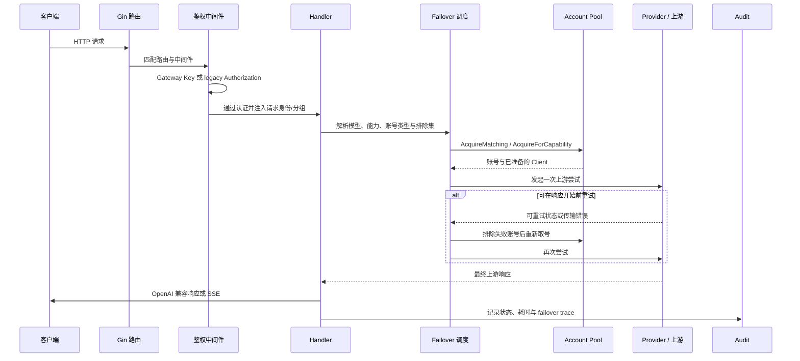

# 网关请求生命周期

## 请求总览

## 路由与身份

- `/v1/*` 主要经 `GatewayKeyAuth` 与 `LegacyAuthorization` 中间件组。网关 Key 可关联分组，用于限制账号集合、类型或模型；非网关 Key 流量继续走 legacy Authorization 兼容路径。身份和过滤细节应以 `internal/handler/router.go` 与对应中间件、网关 Key Store 为准。
- `/admin/api/v1/*` 由 `AdminAuthorization` 保护；`/admin/api/v1/auth/status` 用于管理台检测鉴权状态。当前实现中 `ADMIN_TOKEN` 为空时管理 API 免登放行；配置后只有 `auth/status` 免令牌，其余接口接受 `Authorization: Bearer ...` 或 `X-Admin-Token`。公网部署必须结合网络隔离或配置管理令牌。
- `/auth/*` 提供会话相关端点；`/health` 和 `/healthz` 是公开健康端点。
- 管理台静态文件来自 `web.StaticFS` 中嵌入的 `dist`，不是独立 Web 服务。

## 账号选择与上游执行

处理器根据 endpoint 能力、模型和身份约束构造调度条件。`accounts.Pool` 负责按账号类型和能力筛选可用账号，跳过不可用状态、冷却账号和调用方给定的排除账号；账号的 `EnsureClient` 确保其 HTTP/TLS 客户端可用。

请求执行会关联账号绑定的代理和指纹配置。具体上游编码、协议转换及响应解析位于 `internal/chatgpt/`、`conversion/`、`internal/httpstream/` 与各 handler/provider 实现中。多模态接口有独立处理路径，不应假设文本 Chat 的所有步骤均适用。

## Failover 边界

`internal/handler/failover.go` 定义通用尝试结果、可重试状态与轨迹。具体 handler 决定重试次数和什么错误可重试，因此评审某类请求时要同时看 handler 调用参数和 Failover 实现。

关键边界是**下游响应已开始写出后不能安全切号重放**。对于 SSE，首个响应字节/事件发送后继续读取当前上游，不能再把第二个账号的输出拼接到同一条流。Failover trace 用于审计和运维诊断。

## 管理与可观测性

管理 API 由 `internal/handler/router.go` 注册，包括账号池与代理管理、诊断、系统设置、日志、图库/对话、媒体和工作流接口。请求审计及运维日志由独立缓冲组件提供；同步、巡检和异步登录等任务的状态主要保存在运行期内存中，服务重启后是否恢复要检查各任务的持久化实现。

## 改动检查点

- 新 endpoint 是否注册在正确认证组，OPTIONS、HEAD、文件流等辅助路由是否需要独立注册。
- 账号筛选是否同时约束模型、能力、网关分组与账号类型。
- 是否在写响应前完成全部可能的重试；超时、上下文取消和客户端断开是否正确传递。
- 新错误是否写入审计，并且不会把 Token、代理凭据或敏感上游响应原文输出到日志。
