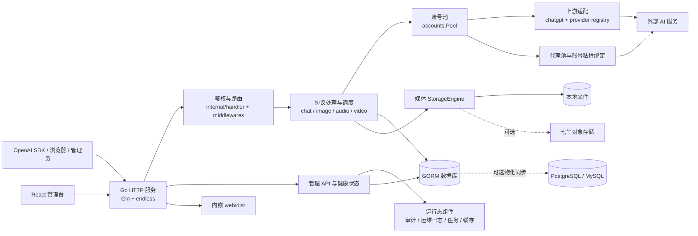

# 系统边界与模块图

## 运行结构

## 启动和依赖装配

`main.go` 处理命令行子命令；普通服务启动时调用 `bootstrap.Init()`，随后用 `endless.ListenAndServe` 或 TLS 版本启动 Gin Router。Serverless 入口 `api/router.go` 在包初始化时调用同一 `bootstrap.Init()` 并通过 `ServeHTTP` 暴露 Router。

`internal/bootstrap/bootstrap.go` 按启动流程加载环境与配置、初始化数据库、加载 Profile 代理节点和账号、建立账号池与 Provider 注册表、启动健康检查及可选后台任务，最后将依赖汇总到 `handler.RouterDeps`。清理函数负责停止同步器及后台循环。

路由层通过 `RouterDeps` 构造 `GatewayRuntime`，再把共享的数据库、账号池、代理池、存储、审计和健康跟踪器交给各处理器。处理器处理 HTTP 协议和业务编排；账号、代理、协议转换、存储等包承载可复用的领域逻辑。

## 主要模块

| 模块 | 职责 | 位置 |
| --- | --- | --- |
| 配置与启动 | 环境配置、数据源选择、初始化和后台任务生命周期 | `internal/config/`、`internal/bootstrap/` |
| API 与管理台 | OpenAI 兼容端点、管理接口、静态资源服务 | `internal/handler/`、`middlewares/`、`web/` |
| 账号调度 | 账号状态、凭据和能力、池内轮询、临时账号 | `internal/accounts/` |
| 上游协议 | ChatGPT Web 协议、供应商插件注册与多模态适配 | `internal/chatgpt/`、`internal/provider/` |
| 出口网络 | Profile 代理池、健康状态、粘性绑定与代理重建 | `internal/proxy/`、`internal/accounts/` |
| 持久化 | 关系模型、文件/数据库加载、可选远端同步 | `internal/db/`、`internal/storage/` |
| 可观测性 | 请求审计、运维日志、健康状态 | `internal/audit/`、`internal/opslog/`、`internal/health/` |
| 专项工作流 | 图像/音频、视频、短剧、提示词、MCP、福利资讯 | `internal/imageflow/`、`internal/audioflow/`、`internal/drama/`、`internal/mcp/`、`internal/promptplaza/`、`internal/deals/` |

## 边界与约束

- Provider 注册表用于能力发现和调用；不同 Provider 的调度入口并不相同，阅读具体 handler 和 executor 后再判断某功能的执行路径。
- 账号通常固定绑定代理和 TLS 指纹配置；代理熔断或管理员变更代理池时才可能重绑定。详见 `openspec/specs/gateway/pool-resilience-and-ops.md`。
- 请求级 Failover 要在向客户端写出响应 Header 或 SSE 首包前决定是否切换账号。流式响应开始后不能透明重放已发送内容。
- Web 前端局部使用 OpenUI 消息渲染。`X-OpenUI-Lang: true` 才触发系统提示注入，不应改变标准 OpenAI 请求默认语义。
- 本服务不是由独立微服务组成的部署拓扑；图中的数据库、上游和对象存储是外部依赖或可选服务。
