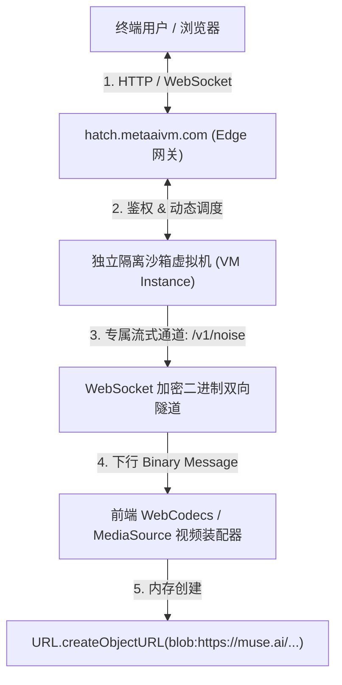
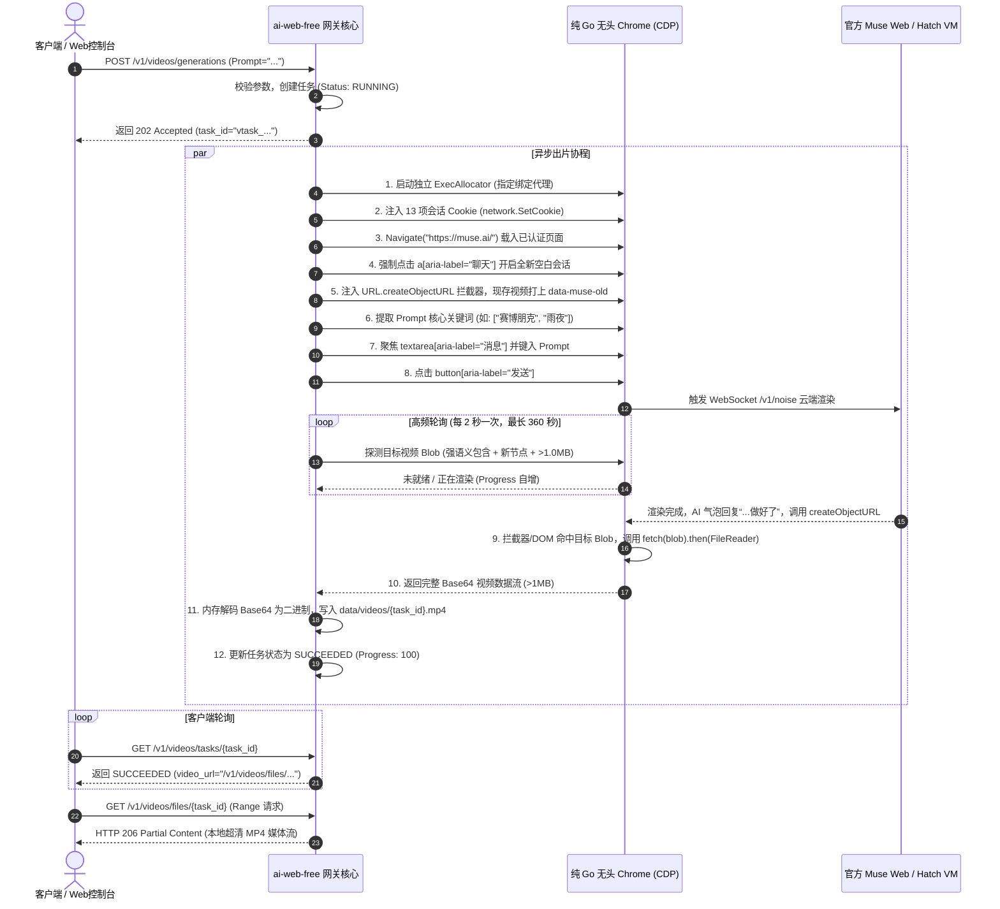

# Meta AI Muse 登录、会话与逆向网关架构设计规范 (Meta Muse Reverse Proxy Architecture)

> **文档标识**：`docs/meta-muse-reverse-proxy.md`  
> **关联 ADR**：[ADR-0010: Meta Muse Web 逆向工程、多模态视频生成与抗串号架构](adr/ADR-0010-20261115-meta-muse-web-reverse-proxy-and-anti-collision-architecture.md)  
> **适用版本**：`ai-web-free` v1.1.0+  
> **设计状态**：正式实施 (Production Ready)  

---

## 1. 架构定位与逆向挑战

### 1.1 平台能力与业务价值
Meta AI 旗下的 **Muse (muse.ai)** 是当前业界极少数提供**免算力消耗、无水印、高电影感画质、且音画完全协同**的顶级 AI 视频生成平台。其具备以下关键特性：
- **原生音视频一体化**：生成的视频自带环境自然音效、配乐与动态物理声效，无需后挂音频合成；
- **免额度/免算力**：官方 Web 平台面向注册用户提供高质量 5 秒 / 10 秒短视频生成能力；
- **多样化模型族**：涵盖 `muse-video`（场景/镜头运镜）与 `muse-talk`（角色数字人口型同步，短剧核心基座）。

### 1.2 为什么常规 HTTP API 逆向完全不可行？
在常规逆向工程中，开发者通常期望通过抓包重放 `POST /api/v1/generate` 完成接口模拟。然而，经过对 Muse Web 端底层通信链路的深度解构，发现其采用了一套极其严密的**云端虚拟机双向加密流式架构**：



1. **动态短期沙箱虚拟机（Hatch VM）**：
   - 每次用户交互或页面水合时，网关动态指派一个专属的虚拟主机实例（如 `vm_id=63a7d4df-498e-4dce-b641-8cf5ff0cbe70`）；
2. **多重加密验签与短效令牌（`auth_token` & `notary_token`）**：
   - 通信隧道 `wss://hatch.metaaivm.com/v1/noise` 携带高强度签名：
     - `auth_token`：基于 Ed25519 算法签名、携带 `ot`（一次性认证令牌）的 JWT；
     - `notary_token`：携带纳秒级 `timeout` 限制、目标 `hostname` 与公钥限制的机器公证令牌；
   - 令牌有效期极短且单次绑定，静态脚本无法在外部伪造生成该公证链路；
3. **私有二进制协议传输（Noise Protocol + Protobuf）**：
   - WebSocket 通信流全部为 `Binary Message` 下行，前端收到二进制数据包后，直接在浏览器运行时装配为 MP4 二进制，并调用 `URL.createObjectURL` 生成 `blob:https://muse.ai/{uuid}` 赋予 `<video>` 播放。

**技术选型结论**：
放弃在外部单纯模拟 HTTP 请求的脆弱方案，**采用纯 Go 原生 Chrome DevTools Protocol (CDP, `chromedp`) 驱动无头 Chrome 进行会话维持、交互驱动与前端内存级 Blob 截流**。这是唯一可对抗官方多变加签、高保真出片的技术路径。

---

## 2. 账号体系与全量 Cookie 鉴权机制

### 2.1 核心凭据矩阵 (13 项必要 Cookie)
Muse 采用了 Meta 统一身份系统与 Hatch 虚拟机会话双层鉴权。单个账号在 `data/ai-web-free.db` 中持久化的 Cookie 长度达 7,500 ~ 8,500 字符，其核心字段分工如下：

| Cookie 键名 | 作用域 (Domain) | 安全属性 | 核心作用与机制 |
| :--- | :--- | :--- | :--- |
| **`hatch_sess`** | `.muse.ai` | `HttpOnly; Secure` | **最核心会话凭证**：绑定用户登录态，缺失直接触发 `HTTP 401: Authentication required` |
| **`hatch_gw`** | `.muse.ai` | `HttpOnly; Secure` | 虚拟机 Edge 网关路由凭证，用于分配 `hatch.metaaivm.com` 入口 |
| **`hatch_vml`** | `.muse.ai` | `HttpOnly; Secure` | 虚拟机实例生命周期凭证，维持长时间连接池 |
| **`__Host-hatch_one_tap`** | `muse.ai` (主机锁定) | `Secure; Path=/` | 防跨站劫持的主机限定凭证，必须严格匹配 `muse.ai` 域名，不可加前导点 |
| **`c_user` / `i_user`** | `.meta.ai` / `.facebook.com` | `Secure` | Meta 统一用户全局 UID，用于多模态模型配额与历史记录索引 |
| **`xs` / `datr`** | `.meta.ai` / `.facebook.com` | `HttpOnly` | 设备指纹与会话防篡改校验票据 |
| **`ps_l` / `ps_n`** | `.muse.ai` | `Secure` | 页面前端 React 状态水合与用户偏好持久化 |

### 2.2 严格零 CGO 与纯 Go 原生提取规范
项目遵循生产环境容器 **零第三方语言环境（No Python, No Node.js）** 与 **纯静态构建（`CGO_ENABLED=0`）** 铁律：
- **禁止外部脚本**：严禁在生产运行时依赖 `python3`、`secretstorage` 或 `cryptography` 去解密本地浏览器；
- **原生 CDP 凭据捕获**：
  在控制台进行「Web 授权（弹窗扫码/账号密码重登）」时，通过纯 Go 的 `network.GetCookies` 或 `network.GetAllCookies().Do(ctx)`，直接从 Chrome 内存的 CDP 树中完整导出包含 HttpOnly 在内的全部 13 项 Cookie；
- **安全脱敏与存储**：
  提取出的全量 Cookie 加密或安全序列化存入纯 Go 驱动的 SQLite（`internal/db`），列表查询仅暴露前中后掩码。

### 2.3 粘性代理（Sticky Proxy）防风控机制
- **IP 与 TLS 指纹粘性**：每个账号绑定固定出口代理配置（如 `http://proxy:port`）；
- **环境伪装**：CDP 启动参数注入 `--disable-blink-features=AutomationControlled`、`--incognito` 与自定义 User-Agent，规避 Chromium 无头检测；
- **防风控漂移**：同一个账号在连续多次生成时保持代理节点不变，仅在代理节点发生故障熔断时触发迁移并重建上下文。

---

## 3. 视频生成逆向流程 (End-to-End Workflow)

网关调度视频任务（`POST /v1/videos/generations`）时的完整执行闭环：



---

## 4. 视频捕获三大陷阱与核心防线设计

在将 Muse 逆向整合进生产网关的过程中，研发团队攻克了三个导致“超时”与“串号”的致命陷阱：

### 陷阱 1：静止预览状态 `duration: NaN` / `readyState: 0` 导致的假性超时
- **故障现象**：
  官方网页端已经显示成片并出现了播放卡片，但后台网关在 120 秒后抛出 `Muse video generation timed out`。
- **根因分析**：
  Muse 生成的视频卡片在用户未主动点击播放前，浏览器出于节省带宽与解码性能考虑，**默认不会预载音视频元数据**。此时访问 `<video>` 元素的 DOM 属性，其 `readyState === 0`，`duration` 为 `NaN`。此前代码若检测 `v.duration > 0`，逻辑永远无法闭环，死等直至超时。
- **解法机制**：
  抛弃对 `duration` 的依赖，改用底层 **`URL.createObjectURL` 拦截器** 与 **DOM 文本语义** 作为出片第一判断依据。

### 陷阱 2：互动吉祥物 Mascot（Avatar）动作片段“提前截胡”
- **故障现象**：
  用户请求“小橘猫打滚”，但下载下来的视频是一个白色的 7 秒毛绒玩具小人动画（大小仅 338 KB），而且生成耗时异常短（仅 20 秒）。
- **根因分析**：
  Muse 页面右下角有官方常驻的数字人吉祥物小部件。每次用户点击发送后，吉祥物会播放一段点头、眨眼的互动小视频（时长恰好 7 秒，大小约 338 KB）。吉祥物在第 20 秒就调用了 `URL.createObjectURL`，拦截器误以为是作品出片，提前结单。
- **解法机制**：
  1. **体积阈值过滤**：真实作品视频体积均大于 1.0 MB（吉祥物仅 338 KB），拦截器过滤 `size > 1000000`；
  2. **DOM 标签排查**：严格排除含有 `hatch-avatar`、`avatar`、`[data-hatch-avatar]` 以及固定定位在底栏的部件；
  3. **完成语前置拦截**：在官方 AI 明确发出“做好了”之前，任何产生的 Blob 一律视为中间过渡动画，坚决不予采纳。

### 陷阱 3：多轮对话历史视频残留引发的“串台/串号”
- **故障现象**：
  用户本次提交“狂暴大洋”，但拉取下来的视频却是上一次生成的“古牌坊”或“小橘猫”。
- **根因分析**：
  Muse 默认在同一个长会话中保留聊天流。当新任务提交时，旧卡片（如带有“小橘猫做好了”或“古代侠客特写做好了”）仍然驻留在 DOM 树中。如果只判断文本是否包含“做好了”，检测器在发送后第 2 秒就会命中上一个气泡，导致串台。
- **防串号三维绝对防线**：

```
                    [提交新 Prompt: "雨夜中的赛博朋克..."]
                                      │
  ┌───────────────────────────────────┼───────────────────────────────────┐
  ▼                                   ▼                                   ▼
【发送前绝对物理标记】               【Prompt 核心关键词提取】              【独立空白新会话】
遍历 DOM 为所有历史 <video>           提取 ["赛博朋克", "雨夜",            点击 a[aria-label="聊天"]
打上 data-muse-old="true" 标记        "未来都会", "悬浮汽车"]              开启 URL 为 "/" 的新会话
并将旧 Blob URL 纳入黑名单
  │                                   │                                   │
  └───────────────────────────────────┼───────────────────────────────────┘
                                      ▼
                        【出片气泡多条件强校验】
      1. 气泡必须包含完成语（"做好了" / "is ready"）
  AND 2. 气泡文本必须包含本次任务核心关键词（如 "赛博朋克"、"雨夜"）
  AND 3. 气泡内 <video> 必须不包含 data-muse-old 属性，且不在历史黑名单中
  AND 4. 若由拦截器捕获，创建时间必须晚于 __muse_send_ts 且大小 > 1.0MB
                                      │
                                      ▼
                      100% 仅捕获当前任务对应的真实成片！
```

---

## 5. 视频流无损提取与流媒体中继服务

### 5.1 浏览器沙箱内 Base64 无损导出
在确认目标 Blob（如 `blob:https://muse.ai/a1d17f3b-...`）后，通过在 Chrome 上下文执行异步 Promise：
```javascript
fetch(blobUrl)
    .then(res => res.blob())
    .then(blob => new Promise((resolve) => {
        const reader = new FileReader();
        reader.onloadend = () => resolve(reader.result); // 导出为 data:video/mp4;base64,...
        reader.onerror = () => resolve('');
        reader.readAsDataURL(blob);
    }));
```
该方式绕过了浏览器的跨域沙箱与文件下载弹窗，纯内存读取高清二进制，并回传至 Go 协程。

### 5.2 零 CGO 媒体流本地分发 (`VideoHandler`)
Go 后端接收 Base64 字节并落盘至本地持久化目录 `data/videos/{task_id}.mp4`。
在路由层（`internal/handler/router.go`）注册高性能流媒体接口：
- `GET /v1/videos/files/:id`
- `HEAD /v1/videos/files/:id`
- `GET /v1/videos/:id/content`

**流媒体特性支持**：
- **`Accept-Ranges: bytes`**：支持浏览器 `<video>` 发起分片请求，支持拖拽进度条；
- **标准响应状态**：首包响应 `HTTP 200 OK` 或分段请求响应 `HTTP 206 Partial Content`；
- **HEAD 预检支持**：客户端探活或预读媒体头部信息返回 `200 OK`，避免 404/405 探测异常。

---

## 6. 对外 API 协议契约 (OpenAI 兼容)

### 6.1 提交异步视频生成
- **请求方式**：`POST /v1/videos/generations`
- **请求头**：`Content-Type: application/json`、`Authorization: Bearer <API_KEY>`
- **请求体**：
  ```json
  {
    "model": "muse-video",
    "prompt": "无量玉壁仙气飘飘的高清唯美短视频，4k电影画质，微风轻拂",
    "duration": 5
  }
  ```
- **同步响应 (202 Accepted)**：
  ```json
  {
    "id": "vtask_42c703b4-67e",
    "task_id": "vtask_42c703b4-67e",
    "model": "muse-video",
    "provider": "meta_muse",
    "status": "PENDING",
    "created_at": 1794676412,
    "eta_seconds": 60
  }
  ```

### 6.2 查询任务进度与成片 URL
- **请求方式**：`GET /v1/videos/tasks/:task_id`
- **成片响应 (200 OK)**：
  ```json
  {
    "task_id": "vtask_42c703b4-67e",
    "provider": "meta_muse",
    "model": "muse-video",
    "prompt": "无量玉壁仙气飘飘的高清唯美短视频...",
    "duration": 5,
    "status": "SUCCEEDED",
    "progress": 100,
    "video_url": "/v1/videos/files/muse_a73881da",
    "created_at": "2026-11-15T01:13:32.60629877+08:00",
    "completed_at": "2026-11-15T01:13:58.618490742+08:00"
  }
  ```

---

## 7. 生产部署与运维指引

### 7.1 无头 Chrome 环境探测链
网关在启动无头渲染协程前，纯 Go 原生自动探测系统可执行文件：
1. 环境变量 `CHROME_PATH` 显式覆盖；
2. 查找 PATH 路径：`google-chrome` -> `google-chrome-stable` -> `chromium` -> `chromium-browser`；
3. 若均未探测到，任务如实返回 `FAILED` 并抛出错误说明，绝不静默伪装。

### 7.2 Docker 容器化最佳实践
对于基于 `gcr.io/distroless/static-debian12:nonroot` 的纯静态镜像，若需要运行 CDP 出片功能，推荐以下轻量解法：
1. **Sidecar 架构**：搭配一个无状态的 Chromium Headless 容器（暴露 CDP 调试端口 `9222`）；
2. **轻量全功能镜像（可选构建目标）**：采用 Debian 基础镜像预装 `chromium`，配合 `CGO_ENABLED=0` 编译的单二进制运行。

### 7.3 常见排错清单
- **报错 `HTTP 401: Authentication required`**：
  Cookie 缺失了 `hatch_sess` 或 `hatch_gw`，在控制台重新执行「Web 授权」或填入全量 Cookie；
- **报错 `listen tcp :18080: bind: address already in use`**：
  存在此前被覆盖删除的旧版本二进制僵尸进程（`/proc/.../exe -> (deleted)`），执行 `kill -9 <PID>` 清理后启动；
- **生成超时（超过 360 秒）**：
  检查绑定的出口代理是否通畅、代理节点是否被 Cloudflare 或 Meta WAF 拦截（可通过控制台账号状态指示灯确认）。
