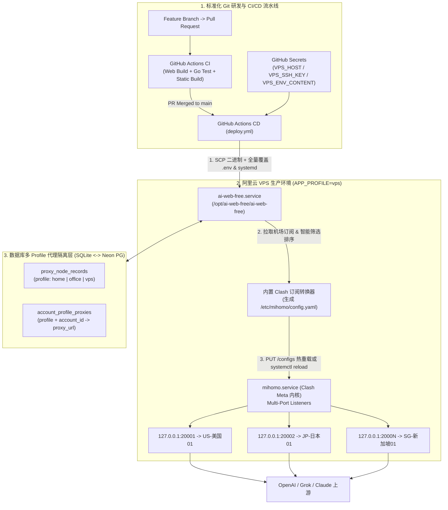

# CI/CD 自动发布、多环境 Profile 代理池与 Clash/Mihomo 多端口网关架构规范

> **状态**：Accepted（对应 `/grill-me` 架构决策 `ADR-0018`）
> **最后更新**：2026-11-21

---

## 1. 背景与设计目标

随着 `ai-web-free` 在多运行时环境（家庭 Windows 开发机、公司局域网开发机、阿里云 Linux 生产 VPS）协同开发与投产，系统需要解决以下四个核心工程问题：

1. **分支保护与标准化研发流程**：`main` 分支禁止直接 `git push`，所有变更必须通过 Pull Request（PR）并经过自动化 CI（前端构建、Go 单测、零 CGO 静态编译校验、Python 脚本单测）通过后方可合并。
2. **PR 合并即自动发布（Continuous Deployment）**：PR 合并进 `main` 分支后，自动触发 GitHub Actions 编译 `linux/amd64` 纯静态二进制（`CGO_ENABLED=0`），通过 SSH/SCP 全量下发 GitHub Secrets 中托管的生产 `.env`、systemd 服务单元与新二进制至阿里云 VPS，完成滚动重启、健康检查与失败自动回滚。
3. **阿里云等国内 VPS 翻墙与 Clash 订阅多端口代理池化**：国内 VPS 无法直连 `chatgpt.com` / `grok.com`。利用现有的 Clash Verge 机场订阅与 **Mihomo（Clash Meta 内核）** 的 `listeners` 特性，将订阅中的 N 个优质节点分别映射为本机连续端口（如 `http://127.0.0.1:20001` ~ `http://127.0.0.1:20050`），每个端口固定绑定一个独立机场出口节点，从而让号池中不同账号粘性绑定不同出口 IP，最大化发挥机场多节点防风控优势。
4. **多运行时环境（Runtime Profile）代理数据数据库化与自动切换**：
   - 家里开发机（`APP_PROFILE=home`）：使用本地代理 `http://127.0.0.1:10809`
   - 公司开发机（`APP_PROFILE=office`）：使用局域网代理 `http://192.168.2.12:10809`
   - 阿里云服务器（`APP_PROFILE=vps`）：使用本机 Mihomo 暴露的多端口节点池 `http://127.0.0.1:20001..2000N`
   - 所有 Profile 的代理节点与账号粘性绑定关系均持久化在数据库中（支持本地 SQLite + 云端 Neon PostgreSQL 物化双向同步），实例启动时根据本地 `.env` 的 `APP_PROFILE` 自动加载对应环境的代理池与专属粘性映射，互不覆盖、互不污染。

---

## 2. 系统总体架构图



---

## 3. 模块一：Git 分支保护与 CI/CD 自动部署规范

### 3.1 `main` 分支保护规范（Branch Protection Rules）

在 GitHub 仓库 `Settings -> Branches -> Branch protection rules`（或 Rulesets）中对 `main` 分支启用以下强制策略（并附带一键配置脚本 `scripts/setup_github_branch_protection.sh` 使用 `gh api` 自动开启）：

- **Require a pull request before merging**：开启（禁止直接 `git push origin main`）。
- **Require status checks to pass before merging**：开启，必选检查项为 `test-and-build`（来自 `.github/workflows/ci.yml`）。
- **Require branches to be up to date before merging**：开启。
- **Do not allow bypassing the above settings**：开启（含管理员一并受 PR 流程约束）。

### 3.2 CI/CD 工作流设计（`.github/workflows/deploy.yml`）

- **触发条件**：
  - `push` 到 `main` 分支（即 PR 合并入 `main` 后立即自动触发）
  - `workflow_dispatch`（支持管理员在 GitHub Actions 页面手动触发重新部署）
- **并发控制**：
  - `concurrency: { group: deploy-production, cancel-in-progress: false }`，确保多次合并排队顺序发布，不会并发写坏 VPS 二进制。
- **GitHub Secrets 清单**：
  | Secret 名称 | 必填 | 说明 |
  | :--- | :--- | :--- |
  | `VPS_HOST` | 是 | 阿里云 VPS 公网 IP 或域名 |
  | `VPS_PORT` | 否 | SSH 端口（默认 `22`） |
  | `VPS_USER` | 否 | SSH 登录用户（默认 `root`） |
  | `VPS_SSH_KEY` | 否 | SSH 私钥（优先尝试密钥认证，失败自动回退到密码登录） |
  | `VPS_SSH_PASSWORD` | 否 | SSH 登录密码（未配置私钥或私钥认证失败时使用 `sshpass` 回退登录；与 `VPS_SSH_KEY` 至少配一项） |
  | `VPS_ENV_CONTENT` | 是 | 完整的生产环境 `.env` 文件内容（包含 `APP_PROFILE=vps`、`DATABASE_URL`、`CLASH_SUB_URL`、`ADMIN_TOKEN` 等），每次 CD 全量覆盖写至 `/opt/ai-web-free/.env`（权限 `0600`） |
- **CD 标准执行步骤**：
  1. **构建前端与内嵌资源**：`cd web && npm ci && npx tsc --noEmit && npm run build`
  2. **运行全量测试**：`go test ./...`
  3. **编译零 CGO 纯静态 Linux 二进制**：
     ```bash
     CGO_ENABLED=0 GOOS=linux GOARCH=amd64 go build -trimpath -ldflags="-s -w" -o dist/ai-web-free .
     ```
  4. **打包部署载荷**：包含 `dist/ai-web-free`、`deploy/systemd/ai-web-free.service`、`deploy/systemd/mihomo.service`、`scripts/setup_vps.sh`。
  5. **远端原子发布与健康校验**：
     - 若 VPS 尚未初始化 `/opt/ai-web-free` 或 `mihomo`，自动运行 `setup_vps.sh` 完成目录创建、Mihomo 二进制安装与 systemd 注册。
     - 将 `VPS_ENV_CONTENT` 全量覆写到 `/opt/ai-web-free/.env`（`chmod 600`），同步更新 `/etc/systemd/system/ai-web-free.service` 并 `systemctl daemon-reload`。
     - 备份当前线上二进制 `/opt/ai-web-free/ai-web-free` -> `/opt/ai-web-free/ai-web-free.bak`。
     - 原子替换新二进制并执行 `systemctl restart ai-web-free`。
     - 轮询本机健康检查端点 `http://127.0.0.1:${SERVER_PORT}/admin/api/v1/auth/status`（最多等待 30 秒）：
       - **成功**：输出部署成功摘要与版本号。
       - **失败**：自动将 `ai-web-free.bak` 回滚为 `ai-web-free` 并重启服务，同时打印 `journalctl -u ai-web-free -n 80` 日志并使 Action 报错。

---

## 4. 模块二：运行时 Profile 与数据库多环境代理隔离

### 4.1 环境变量定义（`.env`）

在 `internal/config/config.go` 与 `env.template` 中新增以下配置项：

```dotenv
# ---------- 运行时环境 Profile 与多环境代理池切换 ----------
# APP_PROFILE: 当前运行环境标识，可选值示例：
#   - home   : 家里 Windows 开发环境（默认代理示例 http://127.0.0.1:10809）
#   - office : 公司局域网开发环境（默认代理示例 http://192.168.2.12:10809）
#   - vps    : 阿里云等生产 VPS 环境（自动对接本机 Mihomo 多端口代理池 127.0.0.1:20001..2000N）
APP_PROFILE=home

# ---------- Clash Verge / Mihomo 机场订阅转多端口代理池（VPS 生产推荐）----------
# CLASH_SUB_URL: 机场 Clash/Mihomo 订阅链接（支持 Base64 或 Clash YAML 订阅）
CLASH_SUB_URL=
# CLASH_SUB_PROFILE: 订阅同步生成的代理节点归属的 Profile（默认 vps）
CLASH_SUB_PROFILE=vps
# CLASH_MULTIPORT_HOST: 多端口监听绑定地址（默认 127.0.0.1，严禁暴露公网防盗刷）
CLASH_MULTIPORT_HOST=127.0.0.1
# CLASH_MULTIPORT_START: 起始分配端口（默认 20001）
CLASH_MULTIPORT_START=20001
# CLASH_MULTIPORT_MAX: 最大映射节点端口数（默认 40，即 20001~20040）
CLASH_MULTIPORT_MAX=40
# CLASH_EXCLUDE_REGEX: 自动剔除的信息节点与高风控地区正则
CLASH_EXCLUDE_REGEX=(?i)(剩余|流量|到期|官网|重置|群|套餐|网址|失联|维护|测试|CN|中国|HK|香港|MO|澳门|RU|俄罗斯|BY|白俄罗斯|IR|伊朗|KP|朝鲜)
# CLASH_PRIORITY_REGIONS: 地区优先级逗号分隔列表（优先分配对 OpenAI/Grok 最友好的地区）
CLASH_PRIORITY_REGIONS=US,JP,SG,TW,KR,DE,UK,NL,CA,AU
# MIHOMO_CONFIG_PATH: 生成的 Mihomo 配置文件路径（默认 /etc/mihomo/config.yaml）
MIHOMO_CONFIG_PATH=/etc/mihomo/config.yaml
# MIHOMO_API_URL: Mihomo External Controller 地址（用于零停机 PUT /configs 热重载）
MIHOMO_API_URL=http://127.0.0.1:9090
# MIHOMO_API_SECRET: Mihomo External Controller 密钥（可选）
MIHOMO_API_SECRET=
# CLASH_SYNC_INTERVAL_HOURS: 后台自动同步机场订阅并刷新多端口间隔（小时，0=仅手动或启动同步，默认 12）
CLASH_SYNC_INTERVAL_HOURS=12
```

### 4.2 数据库表结构升级（`internal/db/models.go`）

为了支持所有环境共用同一套数据库（包括本地 SQLite 与 Neon PostgreSQL 双向物化同步）且互不干扰，设计如下两张表：

#### 1. `ProxyNodeRecord`（`proxy_node_records` 表扩展）

```go
type ProxyNodeRecord struct {
	ID        string    `gorm:"primaryKey;size:64" json:"id"`               // sha1(profile + "|" + url)[:16]
	Profile   string    `gorm:"size:32;default:'home';index" json:"profile"` // home | office | vps | 自定义
	URL       string    `gorm:"size:255;index" json:"url"`                   // http://127.0.0.1:10809 或 http://127.0.0.1:20001
	NodeName  string    `gorm:"size:128" json:"node_name,omitempty"`         // 如 "🇺🇸 美国 01 | IEPL"
	Region    string    `gorm:"size:32;index" json:"region,omitempty"`       // US | JP | SG | TW | KR | OTHER
	Source    string    `gorm:"size:32;default:'manual'" json:"source"`      // manual | clash_sub | env_seed
	Port      int       `gorm:"default:0" json:"port,omitempty"`             // 20001
	Protocol  string    `gorm:"size:32" json:"protocol"`                     // http | socks5
	LatencyMs int64     `gorm:"default:0" json:"latency_ms"`
	Status    string    `gorm:"size:32;default:'active';index" json:"status"` // active | cooling | disabled
	LastError string    `gorm:"type:text" json:"last_error,omitempty"`
	CreatedAt time.Time `gorm:"index" json:"created_at"`
	UpdatedAt time.Time `gorm:"index" json:"updated_at"`
}
```

#### 2. `AccountProfileProxyRecord`（新增 `account_profile_proxies` 表，纳入物化同步）

解决不同 Profile 下同一账号粘性代理隔离的问题：

```go
// AccountProfileProxyRecord 记录账号在特定 Runtime Profile 下的专属粘性代理绑定。
// 主键 ID 为 sha1(profile + "|" + account_key)，确保 home / office / vps 各自拥有独立的粘性绑定，
// 切换本地 .env 的 APP_PROFILE 时自动恢复该环境下的固定出口 IP，绝不污染云库中其他环境的绑定。
type AccountProfileProxyRecord struct {
	ID         string    `gorm:"primaryKey;size:64" json:"id"`
	Profile    string    `gorm:"size:32;index:idx_acct_profile_key" json:"profile"`
	AccountKey string    `gorm:"size:128;index:idx_acct_profile_key" json:"account_key"` // email / chatgpt_account_id / account_id
	ProxyURL   string    `gorm:"size:255" json:"proxy_url"`
	NodeName   string    `gorm:"size:128" json:"node_name,omitempty"`
	UpdatedAt  time.Time `gorm:"index" json:"updated_at"`
	CreatedAt  time.Time `gorm:"index" json:"created_at"`
}
```

### 4.3 默认种子与启动自动切换流程

1. **内置多 Profile 种子引导**：
   - 若数据库中 `home` Profile 尚无记录且设置了 `PROXY_URL`（或处于 `home` 环境），可一键或自动种入 `http://127.0.0.1:10809`。
   - 若用户在管理台或 `.env` 配置了预设（`home` -> `http://127.0.0.1:10809`、`office` -> `http://192.168.2.12:10809`），数据库持久化保存各 Profile 节点。
2. **启动按 `APP_PROFILE` 自动装配**：
   - `bootstrap.Init()` 读取 `cfg.AppProfile`（默认 `home`，大小写归一化）。
   - 调用 `db.LoadProxiesByProfile(database, activeProfile)` 仅加载当前 Profile 下 `status != 'disabled'` 的代理节点进入内存 `proxyPool`。
   - 调用 `db.LoadAccountProfileProxies(database, activeProfile)` 获取当前 Profile 的粘性绑定表：
     - 若账号在该 Profile 下已有粘性代理且该代理在当前 `proxyPool` 中健康，则直接复用；
     - 否则从当前 Profile 的 `proxyPool` 中 `Allocate()` 一个健康代理，并异步写入 `account_profile_proxies` 表（`profile = activeProfile`）。
3. **运行期热切换 Profile**：
   - 当管理员在 UI 切换当前激活 Profile（或 `.env` 重启切换）时，网关自动加载目标 Profile 的代理列表替换 `proxyPool`，并按目标 Profile 的 `account_profile_proxies` 重新绑定所有号池账号的 `acct.Proxy` 并重建 TLS Client，全程零停机。

---

## 5. 模块三：Clash Verge 机场订阅转 Mihomo 多端口代理池方案

### 5.1 为什么采用 Mihomo `listeners` 多端口映射？

普通 Clash 配置只暴露一个 `mixed-port: 7890`，所有请求共享同一个当前选中的节点。对于拥有几十上百个账号的号池而言：
- 如果所有账号走同一个出口 IP，极易触发 OpenAI / Cloudflare 429 速率限制与串号封禁；
- 如果频繁调 Clash API 切节点，并发请求中的 SSE 流会被打断。

利用 **Mihomo（Clash Verge 内核）** 原生支持的 `listeners` 独立入站监听器，可以将机场订阅中的每个节点映射为本机独立端口：

```yaml
# /etc/mihomo/config.yaml (由 ai-web-free 自动生成并热重载)
mixed-port: 7890
allow-lan: false
bind-address: 127.0.0.1
mode: rule
log-level: warning
external-controller: 127.0.0.1:9090

proxies:
  - { name: "🇺🇸 美国 01", type: ss, server: us1.example.com, port: 443, cipher: aes-128-gcm, password: "..." }
  - { name: "🇯🇵 日本 01", type: vmess, server: jp1.example.com, port: 443, uuid: "...", alterId: 0, cipher: auto }
  - { name: "🇸🇬 新加坡 01", type: trojan, server: sg1.example.com, port: 443, password: "..." }

listeners:
  - name: pool-in-20001
    type: mixed
    port: 20001
    listen: 127.0.0.1
    proxy: "🇺🇸 美国 01"
  - name: pool-in-20002
    type: mixed
    port: 20002
    listen: 127.0.0.1
    proxy: "🇯🇵 日本 01"
  - name: pool-in-20003
    type: mixed
    port: 20003
    listen: 127.0.0.1
    proxy: "🇸🇬 新加坡 01"
```

- **混合协议兼容**：`type: mixed` 让每个端口同时支持 `http://127.0.0.1:20001` 与 `socks5://127.0.0.1:20001`（满足 `bogdanfinn/tls-client` 与 `chromedp` 无头浏览器登录卡密的需求）。
- **端口确定性绑定**：生成端口时按节点名称做稳定排序与端口复用（已有同节点名优先保持原端口号 `2000X`），防止订阅刷新后端口号漂移导致账号粘性出口 IP 变化。

### 5.2 智能筛选与地区优先级排序算法（`internal/proxy/clash_sub.go`）

1. **订阅拉取与多格式解析**：
   - 支持直接解析 Clash YAML（提取 `proxies:` 数组）。
   - 支持解析通用 Base64 订阅（`ss://`、`vmess://`、`trojan://`、`vless://`、`hysteria2://` / `hy2://`）并转换为 Mihomo 标准 `proxies` 结构。
2. **垃圾与高危节点过滤**：
   - 使用 `CLASH_EXCLUDE_REGEX` 过滤掉：
     - 机场信息伪节点：`剩余流量`、`套餐到期`、`官网`、`重置`、`群组`、`失联` 等；
     - OpenAI/Claude 锁区或高危风控地区：`CN/中国`、`HK/香港`、`MO/澳门`、`RU/俄罗斯` 等（用户可在 UI 或环境变量自定义调整正则）。
3. **地区识别与优先级打分**：
   - 自动根据节点名称识别国家/地区代码（如 `US/美国/United States` -> `US`，`JP/日本/Tokyo/Osaka` -> `JP`，`SG/新加坡/Singapore` -> `SG`，`TW/台湾/Taiwan` -> `TW`，`KR/韩国/Korea` -> `KR`，`DE/德国` -> `DE`，`UK/英国` -> `UK`）。
   - 按 `CLASH_PRIORITY_REGIONS`（默认 `US > JP > SG > TW > KR > EU > 其他`）排序，截取前 `CLASH_MULTIPORT_MAX`（默认 40）个节点。
4. **配置写出、Mihomo 热重载与数据库同步**：
   - 原子写入 `MIHOMO_CONFIG_PATH`（默认 `/etc/mihomo/config.yaml`）。
   - **优先调用 Mihomo REST API**：`PUT http://127.0.0.1:9090/configs?force=true`（携带 `{"path": "/etc/mihomo/config.yaml"}`），实现毫秒级无损热重载；若 REST API 未响应，则回退尝试 `systemctl reload-or-restart mihomo`。
   - 将生成的 `http://127.0.0.1:20001..2000N`（连同 `NodeName`、`Region`、`Port`、`Source="clash_sub"`）写入数据库目标 Profile（如 `vps`），并保留该 Profile 下用户手动添加（`Source="manual"`）的节点。
   - 若目标 Profile 即为当前激活 Profile，立即调用 `proxyPool.Replace()` 与 `accountPool.ReconcileProxies()`，并可按需并发执行 `ProbeAll` 校验每个端口到 `https://chatgpt.com/cdn-cgi/trace` 的真实连通性与延迟。

---

## 6. 模块四：管理台接口与前端 UI 设计

### 6.1 新增/扩展管理端 API（`/admin/api/v1/proxies/*`）

1. **`GET /admin/api/v1/proxies`（扩展）**
   - 支持 `?profile=home|office|vps` 查询指定 Profile 的节点列表；不传则返回当前激活 Profile。
   - 响应增加：
     - `active_profile`: 当前实例生效的 Profile（如 `"home"`）
     - `env_profile`: `.env` 配置的默认 Profile
     - `profiles`: 数据库中已存在的所有 Profile 概览（含每个 Profile 的节点数：`home`、`office`、`vps`）
     - `clash_config`: 当前 Clash 订阅多端口配置脱敏摘要（订阅是否已配置、起始端口、最大端口数、目标 Profile、上次同步时间与结果）
     - `nodes`: 每个节点除 `url`、`status`、`latency_ms`、`bound_accounts` 外，新增 `profile`、`node_name`、`region`、`source`、`port`。
2. **`POST /admin/api/v1/proxies/profile`（新增：热切换当前激活 Profile）**
   - 请求体：`{"profile": "office"}`
   - 动作：切换网关当前激活 Profile，从数据库加载该 Profile 的代理节点替换内存 `proxyPool`，并按该 Profile 的 `account_profile_proxies` 重新绑定号池所有账号代理。
3. **`POST /admin/api/v1/proxies`（扩展：按 Profile 保存代理）**
   - 请求体增加可选 `profile` 字段（如为 `home` 保存 `http://127.0.0.1:10809`，为 `office` 保存 `http://192.168.2.12:10809`）。
4. **`POST /admin/api/v1/proxies/clash-sync`（新增：一键拉取 Clash 订阅生成多端口并入库）**
   - 请求体（可选覆盖 `.env` 默认值）：
     ```json
     {
       "sub_url": "https://...",
       "target_profile": "vps",
       "listen_host": "127.0.0.1",
       "start_port": 20001,
       "max_ports": 40,
       "exclude_regex": "...",
       "priority_regions": "US,JP,SG,TW,KR",
       "reload_mihomo": true,
       "probe_after_sync": true
     }
     ```
   - 响应：返回解析出的总节点数、过滤剔除数、最终映射的端口明细（`20001 -> 🇺🇸 美国 01` 等）、Mihomo 热重载状态及数据库同步结果。

### 6.2 前端管理台代理池页面（`#/proxies`）升级

在 `web/src/` 代理池治理视图中：
1. **顶部 Runtime Profile 切换栏**：
   - 直观展示当前激活环境徽章（如 `当前激活: home (本地 .env)`），提供 `home (家里)`、`office (公司)`、`vps (生产多端口)` 快捷切换 Tabs 与「设为当前运行 Profile」按钮。
   - 支持一键初始化 `home (127.0.0.1:10809)` / `office (192.168.2.12:10809)` 预设模板。
2. **Clash Verge 机场订阅多端口转换面板**：
   - 可折叠/抽屉卡片，支持配置/预览订阅 URL、起始端口（`20001`）、最大节点数（`40`）、排除地区正则与优先地区；
   - 提供「一键拉取订阅 & 生成多端口入库」与「导出/预览 Mihomo `config.yaml`」按钮。
3. **代理节点表格增强**：
   - 展示每条代理的 **端口 (`:20001`)**、**机场节点名称 (`🇺🇸 美国 01`)**、**地区徽章 (`US`)**、**来源 (`Clash 订阅` / `手动`)**、**实时延迟 (`LatencyMs`)** 与 **粘性绑定账号数 (`BoundAccounts`)**。

---

## 7. 本地开发机实测 Clash 多端口代理池指南（Windows / macOS）

在本地开发机（如 Windows + Clash Verge）无需等待部署 VPS，即可完整实测「机场订阅 → 过滤优选 → 生成 Mihomo 多端口 → 并发探活」全链路：

1. **配置本地 Mihomo 输出路径（`.env`）**：
   ```dotenv
   MIHOMO_CONFIG_PATH=data/mihomo_test.yaml
   ```
   重启本地网关（`go run .`）。
2. **生成多端口配置并入库**：
   - 打开 `http://localhost:18080/#/proxies`，展开 **「Clash 机场订阅转多端口」**；
   - 填入或复用 `.env` 的 `CLASH_SUB_URL`，选择目标 Profile（如 `vps`），点击 **「一键拉取订阅 & 生成多端口入库」**；
   - 可通过 `grep -n "pool-in-" data/mihomo_test.yaml` 校验 `listeners` 端口已生成（`data/` 已被 `.gitignore` 忽略，不会误提交节点密码）。
3. **启动本地 Mihomo 内核实测连通性**：
   - 先临时退出桌面版 Clash Verge（避免 `7890` / `9090` 端口冲突）；
   - 使用 Clash Verge 安装目录自带内核（如 `D:\programs\clash verge\verge-mihomo.exe`）指定 `-d data` 启动（避免在仓库根目录生成 GeoIP 缓存文件）：
     ```bash
     "/d/programs/clash verge/verge-mihomo.exe" -d data -f data/mihomo_test.yaml
     ```
   - 回到管理台 `#/proxies`，将当前运行环境热切换为 `vps` 后点击 **「并发探活当前环境 (vps)」**，即可实时验证每个机场端口到 `https://chatgpt.com/cdn-cgi/trace` 的可用性与延迟。
4. **测试收尾**：
   - 停止测试内核并重新打开桌面版 Clash Verge，在管理台将当前运行环境切回 `home`（`127.0.0.1:10809`）即可恢复日常开发。

