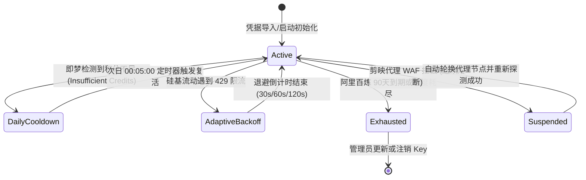
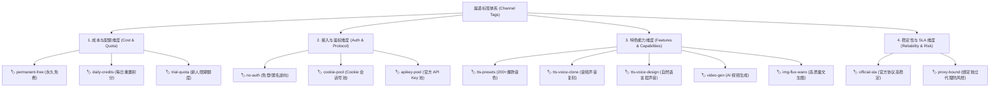

# 免费多模态 API 网关与号池系统设计规范 (Free Multi-Modal Providers Specification)

> **关联 ADR**：[ADR-0009: 详细整理和设计这些免费额度api 需求](../../docs/adr/ADR-0009-20261114-详细整理和设计这些免费额度api-需求.md)  
> **适用版本**：`ai-web-free` v1.1.0+  
> **设计状态**：Accepted

---

## 1. 目标与设计原则

为 `ai-web-free` 扩展覆盖 **字节跳动（ByteDance）**、**阿里云（Alibaba Cloud）** 与 **硅基流动（SiliconFlow）** 等主流平台的免费多模态服务，在严格遵循 **零 CGO 纯 Go 编译** 与 **OpenAI 兼容协议** 前提下，实现高品质的 **TTS 语音合成**、**AI 文生图/图生图** 与 **AI 视频生成** 网关。

### 核心约束
1. **严格零 CGO**：全量 Go 代码基于纯标准库与纯 Go 依赖（`bogdanfinn/tls-client`、`gorilla/websocket`、标准 HTTP），禁止引入任何 SQLite 或 C 绑定。
2. **混合双轨制**：
   - **轨道一（零成本客户端逆向）**：剪映 TTS（200+ 热门抖音爆款音色，免额度/免登录）、即梦 AI（Cookie 号池，每日 66~88 免费积分生成图片与视频）。
   - **轨道二（官方免费配额池）**：硅基流动（FLUX.1-schnell、CosyVoice 永久免费模型）、阿里云百炼 DashScope（CosyVoice、通义万相、Wan 视频 90 天新人免费额度）。
3. **优雅降级与粘性防风控**：模型与音色显式路由，主渠道耗尽或熔断时跨渠道自动降级，保障下游客户端高可用。

---

## 2. 接口契约与协议对齐规范

### 2.1 TTS 语音合成接口 (`/v1/audio/speech` & `/v1/audio/voices`)

#### 1. 合成请求端点：`POST /v1/audio/speech`
* **请求体格式**：
  ```json
  {
    "model": "tts-1",
    "input": "这是一段需要合成的高清语音文本，支持超长篇幅自动切片...",
    "voice": "zh_female_shuangkuai",
    "response_format": "mp3",
    "speed": 1.0
  }
  ```
* **音色路由规则**：
  * 若 `voice` 以 `zh_`、`dy_` 开头或属于剪映音色库，调度至 `internal/provider/jianying`。
  * 若 `voice` 属于 `cosyvoice-*` 或指定 `model: "cosyvoice-v1"`，优先调度至硅基流动免费池；若配置了百炼 Key 则可使用百炼定制音色。
  * 若 `voice` 为 OpenAI 预设音色（`alloy`, `echo`, `fable`, `onyx`, `nova`, `shimmer`），自动映射至剪映或 CosyVoice 的最接近中文音质音色。
* **智能标点长文本切片引擎**：
  * 单句长度阈值：250 个字符。
  * 分词算法：按中英文换行与标点符号（`\n`, `。`, `！`, `？`, `!`, `?`, `；`, `;`）切分成有序句子切片。
  * 并发执行：纯 Go 内存协程并发合成分片（带信号量控制防止 429），依序号以流式 Chunked 形式写入 HTTP Response。

#### 2. 音色元数据端点：`GET /v1/audio/voices`
* **响应格式**：
  ```json
  {
    "voices": [
      {
        "id": "zh_female_shuangkuai",
        "name": "双快姐（解说小美）",
        "provider": "jianying",
        "category": "影视解说",
        "gender": "female",
        "sample_text": "注意看，眼前这个男人叫小帅...",
        "tags": ["热门", "解说", "快节奏"]
      },
      {
        "id": "longxiaochun",
        "name": "龙小春（亲切女声）",
        "provider": "dashscope",
        "category": "自然情感",
        "gender": "female",
        "sample_text": "今天的天气真不错，要一起去散步吗？",
        "tags": ["多情感", "大模型拟真"]
      }
    ]
  }
  ```

---

### 2.2 图像生成聚合接口 (`/v1/images/generations`)

* **请求体格式**：
  ```json
  {
    "model": "wanx-v1",
    "prompt": "赛博朋克未来都市，霓虹雨夜，电影级光影，8k高画质",
    "n": 1,
    "size": "1024x1024",
    "response_format": "url"
  }
  ```
* **供应商派发与降级链**：
  ```mermaid
  flowchart LR
      Req["POST /v1/images/generations"] --> Route{指定 Model}
      Route -->|wanx-v1| W1["阿里云百炼万相"]
      Route -->|jimeng-4.5| J1["字节即梦 AI"]
      Route -->|flux-schnell| S1["硅基流动 FLUX"]

      W1 -.->|配额耗尽/超限| S1
      J1 -.->|当日积分耗尽| S1
      S1 --> Res["返回标准 OpenAI Image 结构"]
  ```
* **异步转同步等待**：
  * 万相与即梦属于异步任务体系，网关内通过 `context.WithTimeout(ctx, 60*time.Second)` 发起短轮询探测，完成后组装标准 OpenAI 响应，避免让轻量级生图客户端适配两阶段复杂协议。

---

### 2.3 视频生成标准接口 (`/v1/videos/generations` & `/v1/videos/tasks/{id}`)

#### 1. 创建视频生成任务：`POST /v1/videos/generations`
* **请求体**：
  ```json
  {
    "model": "jimeng-video-2.0",
    "prompt": "金色的落叶在秋风中缓缓飘落，镜头平缓向前推进，4k，电影质感",
    "image_url": "https://.../source.png",
    "duration": 5,
    "wait": false
  }
  ```
* **响应格式**：
  ```json
  {
    "task_id": "vtask_jm_01j7b8d4k3",
    "status": "PENDING",
    "created_at": 1731570100,
    "eta_seconds": 60
  }
  ```
  > 若传入 `wait: true`，连接将挂起轮询（最长 180s），完成后直接返回下述任务结果。

#### 2. 轮询视频生成状态：`GET /v1/videos/tasks/{task_id}`
* **响应格式**：
  ```json
  {
    "task_id": "vtask_jm_01j7b8d4k3",
    "model": "jimeng-video-2.0",
    "status": "SUCCEEDED",
    "progress": 100,
    "video_url": "https://lf-dreamina.bytegoofy.com/.../output.mp4",
    "duration": 5.0,
    "created_at": 1731570100,
    "completed_at": 1731570155
  }
  ```

---

## 3. 内存任务池与号池状态机设计

### 3.1 零 CGO 内存视频任务池 (`VideoTaskPool`)

* **结构体设计**：
  ```go
  type VideoTask struct {
      TaskID      string    `json:"task_id"`
      Provider    string    `json:"provider"`    // "jimeng" | "wanx"
      ProviderTID string    `json:"provider_tid"`// 上游任务 ID
      Prompt      string    `json:"prompt"`
      Model       string    `json:"model"`
      Status      string    `json:"status"`      // PENDING | RUNNING | SUCCEEDED | FAILED
      Progress    int       `json:"progress"`
      VideoURL    string    `json:"video_url,omitempty"`
      ErrorMsg    string    `json:"error_msg,omitempty"`
      CreatedAt   time.Time `json:"created_at"`
      UpdatedAt   time.Time `json:"updated_at"`
  }
  ```
* **LRU 淘汰与持久化**：
  * 内存最大保留 1000 个最近任务，超出后按 LRU 释放，杜绝内存泄漏。
  * 可选配置 `VIDEO_TASK_DIR`：当配置环境变量时，任务每次状态更新异步写入 `VIDEO_TASK_DIR/{task_id}.json`，启动时自动从目录加载未终结的任务。

### 3.2 分层号池状态机



---

## 4. 前端 React 控制台交互架构

1. **号池管理 (`#/accounts`)**：
   * 扩充标签页：新增 `字节系（即梦/剪映）`、`阿里云百炼`、`硅基流动`。
   * 支持多凭据批量黏贴导入（Cookie 多行导入、API Key 多行导入）。
   * 视觉指标：即梦当日积分剩余环形图、阿里百炼到期倒计时天数、硅基流动可用状态高亮。
2. **语音工坊（TTS Studio, 独立路由 `#/tts`）**：
   * 文本编辑区（带字数统计与段落标记）。
   * 音色分类卡片抽屉（解说类、剧情类、角色类），支持点击试听 3 秒 Preview。
   * 语速调节滑块（0.5x ~ 2.0x）与一键合成试听。
3. **视频工坊（Video Studio, 独立路由 `#/video`）**：
   * 文生视频与图生视频输入面板。
   * 任务排队与生成进度百分比实时动画。
   * 历史生成视频播放器与全屏画中画预览。
4. **图像工坊联动**：
   * 在现有 `#/image` 页面无缝新增即梦与万相模型，提示词工坊与生成记录完全共用现有组件。

---

## 5. 多维度渠道标签体系 (Multi-Dimensional Tagging System)

为了让管理员和终端用户在多供应商、多模态聚合网关中一目了然各渠道的**成本属性、鉴权形态、高阶特性与稳定性**，系统设计了一套四维度的标签体系。

### 5.1 标签四维度分类标准



### 5.2 核心渠道预置标签映射表

| 渠道供应商 | 成本与配额 | 接入鉴权 | 特色能力标签 | 稳定性与 SLA | UI 视觉渲染推荐 |
| :--- | :--- | :--- | :--- | :--- | :--- |
| **剪映 (JianYing)** | `permanent-free` (永久免费) | `no-auth` (免密免登) | `tts-presets` (爆款解说库)<br>`stream-audio` (流式直出) | `proxy-bound` (需代理限流) | 翡翠绿 + 抖音渐变微标 |
| **即梦 AI (Jimeng)** | `daily-credits` (每日66~88分) | `cookie-pool` (Cookie号池) | `video-gen` (5s/10s文生视频)<br>`img-flux-wanx` (2K/4K生图) | `reverse-web` (Web端逆向) | 霓虹紫 + 胶卷微标 |
| **阿里云百炼 (DashScope)** | `trial-quota` (90天新人包) | `apikey-pool` (官方Key池) | `tts-voice-clone` (声音复刻)<br>`tts-voice-design` (文字捏声音)<br>`video-gen` (Wan视频) | `official-sla` (企业级稳定) | 阿里橙 + 金色皇冠徽标 |
| **硅基流动 (SiliconFlow)** | `permanent-free` (永久免费) | `apikey-pool` (官方Key池) | `img-flux-wanx` (FLUX.1快速生图)<br>`tts-presets` (CosyVoice基座) | `official-sla` (官方免维护) | 极光青 + 无限符号徽标 |
| **ChatGPT Web (原生)** | `daily-credits` (分级限频) | `cookie-pool` (Access/Session) | `chat-reasoning` (思考模型)<br>`tool-calling` (工具调用) | `reverse-web` (Web逆向) | 祖母绿 + 对话气泡徽标 |

### 5.3 数据结构契约 (`Go` & `TypeScript`)

```go
// ChannelTag 定义单个渠道或模型标签的元数据
type ChannelTag struct {
    Key       string `json:"key"`        // 唯一标识，如 "tts-voice-clone"
    Label     string `json:"label"`      // 展示名称，如 "音频声音复刻"
    Category  string `json:"category"`   // "cost" | "auth" | "feature" | "reliability"
    Variant   string `json:"variant"`    // "default" | "success" | "warning" | "purple" | "cyan"
    Icon      string `json:"icon"`       // Lucide 图标名，如 "Mic", "Sparkles", "Coins"
    Tooltip   string `json:"tooltip"`    // 鼠标悬停解释说明
}

// ProviderDescriptor 扩展增加 Tags 字段
type ProviderDescriptor struct {
    // ... 既有字段保持兼容
    Tags        []ChannelTag `json:"tags"`         // 供应商级别标签
    CostType    string       `json:"cost_type"`    // "permanent_free" | "daily_credits" | "trial_quota"
    AuthType    string       `json:"auth_type"`    // "no_auth" | "cookie" | "api_key"
}
```

### 5.4 调度与控制台交互集成

1. **号池管理 (`#/accounts`) 过滤器**：
   * 顶部提供动态标签过滤栏（Filter Bar）：支持按「永久免费」、「每日重置」、「支持声音复刻」等一键多选筛选账号。
2. **工坊选择器视觉强化**：
   * 在「语音工坊」和「图像工坊」下拉框中，每个模型或音色项右侧渲染紧凑型微型徽章（Pill Badge），使用户在选择时即刻知晓其背后的配额性质与能力。
3. **网关智能请求 Header 支持**：
   * 客户端可在调用时传入偏好 Header：`X-Prefer-Tag: permanent-free` 或 `X-Require-Feature: tts-voice-clone`，网关调度器将优先仅在符合标签条件的健康可用账号池中轮询派发。
