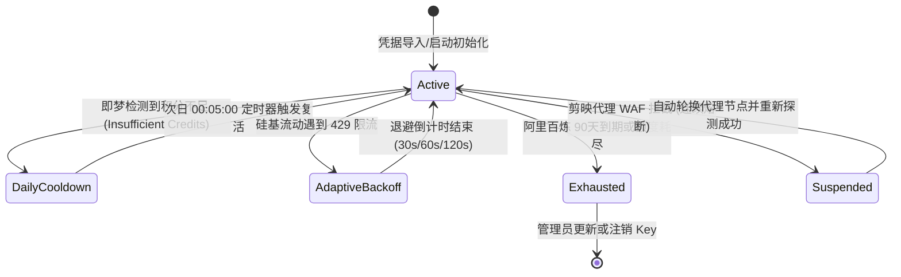
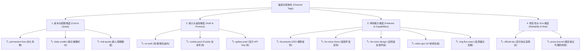

# 免费多模态 API 网关与号池系统设计规范 (Free Multi-Modal Providers Specification)

> **关联 ADR**：[ADR-0009: 详细整理和设计这些免费额度api 需求](../../docs/adr/ADR-0009-20261114-详细整理和设计这些免费额度api-需求.md)  
> **适用版本**：`ai-web-free` v1.1.0+  
> **设计状态**：Accepted

---

## 1. 目标与设计原则

为 `ai-web-free` 扩展覆盖 **字节跳动（ByteDance）**、**阿里云（Alibaba Cloud）** 与 **硅基流动（SiliconFlow）** 等主流平台的免费多模态服务，在严格遵循 **零 CGO 纯 Go 编译** 与 **OpenAI 兼容协议** 前提下，实现高品质的 **TTS 语音合成**、**AI 文生图/图生图** 与 **AI 视频生成** 网关。

### 核心约束
1. **严格零 CGO**：全量 Go 代码基于纯标准库与纯 Go 依赖（`bogdanfinn/tls-client`、`gorilla/websocket`、标准 HTTP），禁止引入任何 SQLite 或 C 绑定。
2. **混合双轨制**：
   - **轨道一（零成本免密云端 + 可选自定义 OpenAI 兼容通道）**：微软 Edge-TTS v2 签名逆向（纯云端推理、零本地算力占用、免密无额度限制，支持 `/voices/list` 实时同步）、即梦 AI（Cookie 号池，每日 66~88 免费积分生成图片与视频），并兼容通过 `CUSTOM_TTS_BASE_URL` / `LOCAL_TTS_BASE_URL` 接入外部 OpenAI 兼容 TTS 端点或自建 Kokoro-FastAPI 节点。原字节剪映旧免密域名 `api-normal-c-lq.zijieapi.com` 已永久下线（`NXDOMAIN`），已退役禁用。
   - **轨道二（云端官方 API Key 配额池）**：硅基流动（`SILICONFLOW_API_KEY`，解锁 `FunAudioLLM/CosyVoice2-0.5B`、FLUX.1-schnell、CogVideoX）、阿里云百炼 DashScope（`DASHSCOPE_API_KEY`，WebSocket `SpeechSynthesizer` 流式/REST 兜底支持 `cosyvoice-v3-flash`/`v2`/`v1`、文字捏声音与音频复刻、通义万相、Wan 视频）。
3. **显式路由与禁止静默音色塌缩**：音色按 ID/请求头严格路由至对应引擎；默认拒绝隐式替换为 ChatGPT `cove`，仅当调用方显式传 `X-Allow-Fallback: true` 时执行独立映射兜底，并在响应头返回 `X-TTS-Provider`、`X-TTS-Voice`、`X-TTS-Fallback`。

---

## 2. 接口契约与协议对齐规范

### 2.1 TTS 语音合成接口 (`/v1/audio/speech` & `/v1/audio/voices`)

#### 1. 合成请求端点：`POST /v1/audio/speech`
* **请求体格式**：
  ```json
  {
    "model": "tts-1",
    "input": "这是一段需要合成的高清语音文本，支持超长篇幅自动切片...",
    "voice": "zh-CN-XiaoxiaoNeural",
    "response_format": "mp3",
    "speed": 1.0
  }
  ```
* **音色路由规则**：
  * 若 `voice` 属于 Kokoro/本地音色（如 `zf_xiaoxiao`, `zm_yunxi`, `kokoro:*`）或 `X-Prefer-Provider: local_tts`，调度至 `internal/provider/local_tts_provider.go`。
  * 若 `voice` 属于微软神经音色（如 `zh-CN-XiaoxiaoNeural`）或 `X-Prefer-Provider: edge_tts`，调度至 `internal/provider/edge_tts.go`（`readaloud/edge/v1`）。
  * 若 `voice` 属于 `FunAudioLLM/CosyVoice2-0.5B:*` / `cosyvoice-v1:*` 或 `X-Prefer-Provider: siliconflow`，调度至硅基流动池（`CosyVoice2-0.5B`）；若为百炼 `long*` / `custom_*` / `designed_*`，调度至百炼 DashScope。
  * 若 `voice` 为 OpenAI 预设音色（`alloy`~`shimmer`），有已登录 ChatGPT 账号时走官方映射；无账号时自动按独立映射调度至 `local_tts` -> `edge_tts`（各音色一一独立映射，禁止折叠）。
  * 未知或已下线（如旧 `zh_*` 剪映）音色默认返回 HTTP `400` / `410`；仅在显式携带 `X-Allow-Fallback: true` 时按音色区分映射降级。
* **智能标点长文本切片引擎**：
  * 单句长度阈值：300 个字符（`SplitTextForTTS`），按中英文标点切分并顺序拼接无损输出。

#### 2. 音色目录、本地样音拉取与试听缓存端点
* `GET /v1/audio/voices`：聚合 `local_tts`、`edge_tts`、`siliconflow`、`dashscope`、`chatgpt` 音色及 `available`、`cached_local`、`preview_url` 与 `providers` 实时状态摘要。
* `GET /v1/audio/voices/:id/preview`（含 `?id=` 兼容路由 `/v1/audio/voice-preview`）：优先读取本地 `voice_samples/*.mp3`（响应头 `X-Voice-Cache: hit`）；未命中时严格按原音色实时合成并持久化保存。
* `POST /v1/audio/voices/pull-local`：同步实时音色清单写入 `voices/catalog.json`（启动时自动回填），并并发预拉取精选音色试听 MP3 至本地存储。

---

### 2.2 图像生成聚合接口 (`/v1/images/generations`)

* **请求体格式**：
  ```json
  {
    "model": "wanx-v1",
    "prompt": "赛博朋克未来都市，霓虹雨夜，电影级光影，8k高画质",
    "n": 1,
    "size": "1024x1024",
    "response_format": "url"
  }
  ```
* **供应商派发与降级链**：
  ```mermaid
  flowchart LR
      Req["POST /v1/images/generations"] --> Route{指定 Model}
      Route -->|wanx-v1| W1["阿里云百炼万相"]
      Route -->|jimeng-4.5| J1["字节即梦 AI"]
      Route -->|flux-schnell| S1["硅基流动 FLUX"]

      W1 -.->|配额耗尽/超限| S1
      J1 -.->|当日积分耗尽| S1
      S1 --> Res["返回标准 OpenAI Image 结构"]
  ```
* **异步转同步等待**：
  * 万相与即梦属于异步任务体系，网关内通过 `context.WithTimeout(ctx, 60*time.Second)` 发起短轮询探测，完成后组装标准 OpenAI 响应，避免让轻量级生图客户端适配两阶段复杂协议。

---

### 2.3 视频生成标准接口 (`/v1/videos/generations` & `/v1/videos/tasks/{id}`)

#### 1. 创建视频生成任务：`POST /v1/videos/generations`
* **请求体**：
  ```json
  {
    "model": "jimeng-video-2.0",
    "prompt": "金色的落叶在秋风中缓缓飘落，镜头平缓向前推进，4k，电影质感",
    "image_url": "https://.../source.png",
    "duration": 5,
    "wait": false
  }
  ```
* **响应格式**：
  ```json
  {
    "task_id": "vtask_jm_01j7b8d4k3",
    "status": "PENDING",
    "created_at": 1731570100,
    "eta_seconds": 60
  }
  ```
  > 若传入 `wait: true`，连接将挂起轮询（最长 180s），完成后直接返回下述任务结果。

#### 2. 轮询视频生成状态：`GET /v1/videos/tasks/{task_id}`
* **响应格式**：
  ```json
  {
    "task_id": "vtask_jm_01j7b8d4k3",
    "model": "jimeng-video-2.0",
    "status": "SUCCEEDED",
    "progress": 100,
    "video_url": "https://lf-dreamina.bytegoofy.com/.../output.mp4",
    "duration": 5.0,
    "created_at": 1731570100,
    "completed_at": 1731570155
  }
  ```

---

## 3. 内存任务池与号池状态机设计

### 3.1 零 CGO 内存视频任务池 (`VideoTaskPool`)

* **结构体设计**：
  ```go
  type VideoTask struct {
      TaskID      string    `json:"task_id"`
      Provider    string    `json:"provider"`    // "jimeng" | "wanx"
      ProviderTID string    `json:"provider_tid"`// 上游任务 ID
      Prompt      string    `json:"prompt"`
      Model       string    `json:"model"`
      Status      string    `json:"status"`      // PENDING | RUNNING | SUCCEEDED | FAILED
      Progress    int       `json:"progress"`
      VideoURL    string    `json:"video_url,omitempty"`
      ErrorMsg    string    `json:"error_msg,omitempty"`
      CreatedAt   time.Time `json:"created_at"`
      UpdatedAt   time.Time `json:"updated_at"`
  }
  ```
* **LRU 淘汰与持久化**：
  * 内存最大保留 1000 个最近任务，超出后按 LRU 释放，杜绝内存泄漏。
  * 可选配置 `VIDEO_TASK_DIR`：当配置环境变量时，任务每次状态更新异步写入 `VIDEO_TASK_DIR/{task_id}.json`，启动时自动从目录加载未终结的任务。

### 3.2 分层号池状态机



---

## 4. 前端 React 控制台交互架构

1. **号池管理 (`#/accounts`)**：
   * 扩充标签页：新增 `字节系（即梦/剪映）`、`阿里云百炼`、`硅基流动`。
   * 支持多凭据批量黏贴导入（Cookie 多行导入、API Key 多行导入）。
   * 视觉指标：即梦当日积分剩余环形图、阿里百炼到期倒计时天数、硅基流动可用状态高亮。
2. **语音工坊（TTS Studio, 独立路由 `#/tts`）**：
   * 文本编辑区（带字数统计与段落标记）。
   * 音色分类卡片抽屉（解说类、剧情类、角色类），支持点击试听 3 秒 Preview。
   * 语速调节滑块（0.5x ~ 2.0x）与一键合成试听。
3. **视频工坊（Video Studio, 独立路由 `#/video`）**：
   * 文生视频与图生视频输入面板。
   * 任务排队与生成进度百分比实时动画。
   * 历史生成视频播放器与全屏画中画预览。
4. **图像工坊联动**：
   * 在现有 `#/image` 页面无缝新增即梦与万相模型，提示词工坊与生成记录完全共用现有组件。

---

## 5. 多维度渠道标签体系 (Multi-Dimensional Tagging System)

为了让管理员和终端用户在多供应商、多模态聚合网关中一目了然各渠道的**成本属性、鉴权形态、高阶特性与稳定性**，系统设计了一套四维度的标签体系。

### 5.1 标签四维度分类标准



### 5.2 核心渠道预置标签映射表

| 渠道供应商 | 成本与配额 | 接入鉴权 | 特色能力标签 | 稳定性与 SLA | UI 视觉渲染推荐 |
| :--- | :--- | :--- | :--- | :--- | :--- |
| **剪映 (JianYing)** | `permanent-free` (永久免费) | `no-auth` (免密免登) | `tts-presets` (爆款解说库)<br>`stream-audio` (流式直出) | `proxy-bound` (需代理限流) | 翡翠绿 + 抖音渐变微标 |
| **即梦 AI (Jimeng)** | `daily-credits` (每日66~88分) | `cookie-pool` (Cookie号池) | `video-gen` (5s/10s文生视频)<br>`img-flux-wanx` (2K/4K生图) | `reverse-web` (Web端逆向) | 霓虹紫 + 胶卷微标 |
| **阿里云百炼 (DashScope)** | `trial-quota` (90天新人包) | `apikey-pool` (官方Key池) | `tts-voice-clone` (声音复刻)<br>`tts-voice-design` (文字捏声音)<br>`video-gen` (Wan视频) | `official-sla` (企业级稳定) | 阿里橙 + 金色皇冠徽标 |
| **硅基流动 (SiliconFlow)** | `permanent-free` (永久免费) | `apikey-pool` (官方Key池) | `img-flux-wanx` (FLUX.1快速生图)<br>`tts-presets` (CosyVoice基座) | `official-sla` (官方免维护) | 极光青 + 无限符号徽标 |
| **ChatGPT Web (原生)** | `daily-credits` (分级限频) | `cookie-pool` (Access/Session) | `chat-reasoning` (思考模型)<br>`tool-calling` (工具调用) | `reverse-web` (Web逆向) | 祖母绿 + 对话气泡徽标 |

### 5.3 数据结构契约 (`Go` & `TypeScript`)

```go
// ChannelTag 定义单个渠道或模型标签的元数据
type ChannelTag struct {
    Key       string `json:"key"`        // 唯一标识，如 "tts-voice-clone"
    Label     string `json:"label"`      // 展示名称，如 "音频声音复刻"
    Category  string `json:"category"`   // "cost" | "auth" | "feature" | "reliability"
    Variant   string `json:"variant"`    // "default" | "success" | "warning" | "purple" | "cyan"
    Icon      string `json:"icon"`       // Lucide 图标名，如 "Mic", "Sparkles", "Coins"
    Tooltip   string `json:"tooltip"`    // 鼠标悬停解释说明
}

// ProviderDescriptor 扩展增加 Tags 字段
type ProviderDescriptor struct {
    // ... 既有字段保持兼容
    Tags        []ChannelTag `json:"tags"`         // 供应商级别标签
    CostType    string       `json:"cost_type"`    // "permanent_free" | "daily_credits" | "trial_quota"
    AuthType    string       `json:"auth_type"`    // "no_auth" | "cookie" | "api_key"
}
```

### 5.4 调度与控制台交互集成

1. **号池管理 (`#/accounts`) 过滤器**：
   * 顶部提供动态标签过滤栏（Filter Bar）：支持按「永久免费」、「每日重置」、「支持声音复刻」等一键多选筛选账号。
2. **工坊选择器视觉强化**：
   * 在「语音工坊」和「图像工坊」下拉框中，每个模型或音色项右侧渲染紧凑型微型徽章（Pill Badge），使用户在选择时即刻知晓其背后的配额性质与能力。
3. **网关智能请求 Header 支持**：
   * 客户端可在调用时传入偏好 Header：`X-Prefer-Tag: permanent-free` 或 `X-Require-Feature: tts-voice-clone`，网关调度器将优先仅在符合标签条件的健康可用账号池中轮询派发。

---

## 6. 全工坊纯云端推理、短剧高频音色矩阵与 Chat 媒体爬虫系统库 (`#/chat`, `#/tts`, `#/image`, `#/video`, `#/short-drama`)

1. **纯云端零本地模型推理约束**：
   - 由于本地部署环境无独立 GPU/大容量算力资源，语音（TTS/克隆）、生图（文生图/图生图）、视频生成与短剧管线均通过 **免密云端通道（Edge-TTS 等） + 可选云端 API Key（SiliconFlow / DashScope / 即梦 / Meta Muse / `CUSTOM_TTS_BASE_URL`）** 调度推理，严禁默认引导用户在本地硬件部署模型服务。
   - 全部四大创作工坊均提供统一 `<CloudKeyConfigModal />` 入口，就地录入 `SILICONFLOW_API_KEY`、`DASHSCOPE_API_KEY`、`JIMENG_SESSION_ID`、`META_COOKIE` 或 `CUSTOM_TTS_BASE_URL` 即可实时激活对应云端通道（无需重启）。
2. **短剧高频角色音色与预设矩阵**：
   - `EnrichShortDramaVoices` 为 Edge-TTS、硅基流动 CosyVoice2-0.5B 与阿里云百炼 CosyVoice 精选音色自动标注 `"短剧常用"` 及剧组角色标签（`霸总男主`、`大女主`、`甜宠千金`、`冷酷反派`、`悬疑旁白`、`热血战神`、`搞笑方言`、`港风粤语`、`台偶言情`、`出海英音` 等）。
   - 图像工坊新增短剧定妆/分镜预设模板，视频工坊新增短剧竖屏运镜预设（`短剧常用` 分类）。
3. **Chat 统一网页爬虫工具与跨工坊系统库复用**：
   - 新增纯 Go 爬虫引擎 `internal/provider/media_crawler.go`（内置 SSRF 内网/回环 IP 防护，支持直链、HTML `<audio>`/`<source>`/``/`<video>`/OG/JSON-LD 提取及 Wikimedia Commons / Bing 公开搜索）。
   - 新增统一接口：`POST /v1/audio/voices/crawl`、`POST /v1/audio/voices/crawl-import`、`POST /v1/audio/voices/custom/:id/clone`、`DELETE /v1/audio/voices/custom/:id`、`POST /v1/media/crawl`、`POST /v1/media/crawl-import`、`GET /v1/media/assets`（含 `/admin/api/v1/media/*` 映射）。
   - **先查后爬与本地入库复用闭环**：
     - 语音样本：先在现有系统/短剧音色库检索；未命中时爬虫抓样并缓存至 `voice_samples/`，同时通过 SiliconFlow `/v1/uploads/audio/voice`（支持本地采集音频转 `data:audio/...;base64,...` 直传，无需公网回调地址）或 DashScope `VoiceCloning` 复刻为 `speech:...` / `cosyvoice-...` 音色，持久化于 `voices/custom_voices.json`。无 Key 时暂存为 `cached_pending_key`，待补充 Key 后支持一键「云端复刻」，并在 `#/tts`、`#/short-drama` 与 `POST /v1/audio/speech` 中透明路由复用。
     - 参考图像与视频片段：爬虫下载缓存至 `images/` / `videos/` 并分别写入 `GalleryWork`（`model: "crawled-ref"`）与 `VideoTask`（`provider: "crawler"`），立即在 `#/image`（「设为参考图」）、`#/video`（「项目素材库」）与 `#/short-drama`（全平台画廊导入）中直接复用。


## 7. xAI Grok Web 免费号池插件规范 (`provider: grok`)

### 7.1 核心特性与架构定位
- **定位**：基于 grok.com / X Web 逆向协议的免费号池插件，支持 Grok-3 / Grok-2 对话与 Grok-2-Image (Aurora) 高清文生图。
- **状态**：`enabled`，已完全接入网关号池控制台、OpenAI `/v1/chat/completions` 与 `/v1/images/generations` 路由。
- **账号凭据**：支持 `sso` 与 `sso-rw` Cookie 凭据（格式：`sso=...; sso-rw=...;` 或 `user@example.com----sso=...;`）。
- **持久化**：启动时自动从 `GROK_ACCOUNTS_FILE`（默认 `grok_accounts.txt`）读取，并支持管理台热导入写回。

### 7.2 热池与待命池阈值调谐
完全遵从分供应商策略模型，支持环境变量精准控制：
- `POOL_GROK_FREE_ACTIVE_TARGET`：热池活跃账号数量上限（0 为不限）。
- `POOL_GROK_FREE_MIN_HEALTHY`：热池健康可用下限，低于此值立即补位。
- `POOL_GROK_FREE_MAX_ACTIVE`：硬上限防止突发超量。
- `POOL_GROK_FREE_ROTATE_INTERVAL` 与 `ROTATE_RATIO`：支持定时轮换热池账号。
- `POOL_GROK_FREE_ACTIVATE_BATCH`：每轮调谐激活步长。
- 自动自愈：当热池中账号遭遇 429 限流或失效时，自动触发 `Rebalance()` 从 `standby` 待命池补位激活。

### 7.3 卡密 SSO 刷新与管理端任务

- `ai-web-free grok-login` 支持从 `邮箱|密码|2FA密钥` 卡密批量登录 `accounts.x.ai`，并在回跳 Grok 后提取 `sso` / `sso-rw` Cookie；第三列也接受 JWT（`eyJ...`）或旧 SSO Cookie。当第三列为 JWT（`eyJ...`）时，系统自动将其映射为活跃 SSO 会话 Cookie（`sso=...; sso-rw=...`），账号导入即上线可用并支持即刻测活，同时保留原始账密用于后续有头重登。
- 工具基于既有纯 Go `chromedp` 依赖执行，支持 `--proxy`、`--browser-path`、`--limit`、`--account`、`--timeout`、`--headless` 与 `--merge`；输出为 `email----sso=...; sso-rw=...`，可直接作为 `GROK_ACCOUNTS_FILE` 凭据行导入。
- CLI 与管理端批量登录默认无头运行；遇到必须人工完成的挑战时，管理员可显式选择有头模式。输出文件使用同目录临时文件原子替换，并设置为仅当前用户可读写（Windows 上权限语义由文件系统决定）。
- 管理端 Grok 供应商支持 `auto`、`kami` 与 `cookie` 三种导入格式；`auto` 为默认值并逐行识别同一批混合凭据（`|` 卡密、`----` 卡密、旧版 `email----SSO`、纯 SSO Cookie）。确定性解析失败的行可在显式开启 `GROK_CREDENTIAL_LLM_ENABLED` 后批量交给 SiliconFlow 低成本模型归一化；LLM 输出必须重新通过 Grok 格式校验与“所有敏感值必须来自原始行”的防幻觉校验，未通过行仍按失败处理，且原始行与 LLM 响应不得写入日志。LLM 成功后会将原行与标准行双双脱敏为占位符模板，并保存到数据库 `credential_format_pattern_records`；后续相同格式直接离线渲染与校验，不再调用外部模型，模板连续误判 3 次后自动停用。卡密导入后创建异步串行 SSO 提取任务，成功后写回 Cookie、激活账号并持久化；已有 SSO Cookie 直接导入。任务状态、排队位置、取消排队与结果横幅复用 ChatGPT 卡密任务模型。
- Linux 服务器执行浏览器登录时必须提供外部 Chrome/Chromium（推荐 `CHROME_PATH` 指向可执行文件）；网关二进制仍保持零 CGO / distroless 静态部署，不内嵌浏览器。
