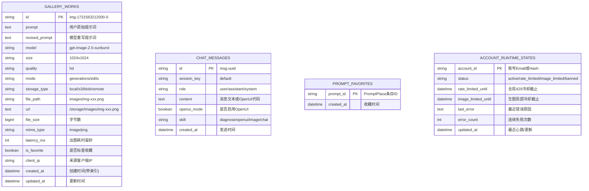

# 生产级多驱动持久化数据库与全局图像工坊/会话存储规范

## 1. 设计目标与背景 (Context & Objectives)

在当前版本中，AI-Web-Free 平台的大部分用户态与运行时数据依赖于浏览器的本地存储（IndexedDB / LocalStorage）或 Go 内存结构：
- **痛点 1（用户直观体验）**：图像工坊（ImageStudio）生成的作品仅以二进制 Blob 形式暂存于浏览器本地 IndexedDB（`ai_web_free_studio_db` 中的 `images` 表）。用户更换浏览器、切换设备、开启无痕模式或清理浏览器缓存后，作品全部丢失。
- **痛点 2（对话历史与收藏丢失）**：AI Copilot 诊断对话记录（`chats` 表）与提示词广场收藏（LocalStorage `ai_web_free_fav_prompts_v1`）同样受限于单机浏览器沙箱，无法跨端同步。
- **痛点 3（后端运行态重置）**：号池节点遭遇 429 或生图限流后的冷却截至时间（`CooldownUntil` / `ImageCooldownUntil`）、封禁标记与临时生成的免密设备账号仅存放在 Go 运行时内存中，服务重启后丢失冷却上下文。

### 1.1 核心工程约束闭环 (Constraints)

1. **严格零 CGO 与纯静态编译（`CGO_ENABLED=0`）**：
   - 生产镜像基于 `gcr.io/distroless/static-debian12:nonroot`，禁止引入任何 CGO 绑定（如 `mattn/go-sqlite3`）。
   - SQLite 必须使用纯 Go 实现驱动（如 `github.com/glebarez/sqlite` / `modernc.org/sqlite`）。
2. **多驱动统一抽象与无感降级**：
   - 默认模式：开箱即用，单文件 SQLite 本地落盘（默认路径 `data/ai-web-free.db`）。
   - 企业级集群模式：支持配置 `DATABASE_URL`（如 `postgres://...` 或 `mysql://...`），适配外部高可用数据库。
   - 无盘/只读容器兼容：当运行在未挂载持久卷且文件系统只读的无根容器时，支持自动降级或显式配置 `:memory:` 纯内存数据库，绝不因目录无写权限导致 panic。
3. **混合分层存储引擎（Hybrid Storage Engine）**：
   - 针对单张 1~3MB 的 PNG 图片文件，避免数据库文件急剧膨胀，采用「文件系统/对象存储放二进制，数据库仅存结构化元数据」的经典架构。
   - 默认本地磁盘优先（`data/storage/images/{id}.png`），由 Gin 路由统一托管分发；
   - 可选 S3 兼容对象存储插件（AWS S3 / Cloudflare R2 / MinIO），配置对应环境变量时自动无感接入。
4. **平滑迁移与前端存量兼容**：
   - 针对已有用户浏览器 IndexedDB 中的历史存量作品，提供非破坏性的顶部引导横幅（NoticeBanner），支持一键批量上报/同步到服务端数据库。

---

## 2. 数据库架构与数据模型设计 (Data Models & Schema)

采用 **GORM 纯 Go 生态（`gorm.io/gorm`）** 配合纯 Go 驱动（SQLite / Postgres / MySQL），利用 `db.AutoMigrate(...)` 在服务启动时自动完成表结构建表与安全平滑升级。



### 2.1 图像工坊作品表 (`gallery_works`)

```go
type GalleryWork struct {
    ID            string    `gorm:"primaryKey;size:64" json:"id"`
    Prompt        string    `gorm:"type:text;not null" json:"prompt"`
    RevisedPrompt string    `gorm:"type:text" json:"revised_prompt,omitempty"`
    Model         string    `gorm:"size:64;index" json:"model"`
    Size          string    `gorm:"size:32" json:"size"`
    Quality       string    `gorm:"size:32" json:"quality,omitempty"`
    Mode          string    `gorm:"size:32;default:'generations'" json:"mode"`
    StorageType   string    `gorm:"size:32;default:'local'" json:"storage_type"` // local, s3, blob, remote
    FilePath      string    `gorm:"size:255" json:"file_path,omitempty"`
    URL           string    `gorm:"type:text;not null" json:"url"`
    BlobData      []byte    `gorm:"type:blob" json:"-"`                          // 仅在无磁盘模式下作为纯内存/库内兜底
    FileSize      int64     `json:"file_size"`
    MimeType      string    `gorm:"size:64;default:'image/png'" json:"mime_type"`
    LatencyMs     int       `json:"latency_ms"`
    IsFavorite    bool      `gorm:"default:false;index" json:"is_favorite"`
    ClientIP      string    `gorm:"size:64" json:"client_ip,omitempty"`
    CreatedAt     time.Time `gorm:"index" json:"created_at"`
    UpdatedAt     time.Time `json:"updated_at"`
}
```

### 2.2 AI Copilot 对话记录表 (`chat_messages`)

```go
type ChatMessageRecord struct {
    ID         string    `gorm:"primaryKey;size:64" json:"id"`
    SessionKey string    `gorm:"size:64;index;default:'default'" json:"session_key"`
    Role       string    `gorm:"size:32" json:"role"` // user, assistant, system
    Content    string    `gorm:"type:longtext" json:"content"`
    OpenUIMode bool      `gorm:"default:false" json:"openui_mode"`
    Skill      string    `gorm:"size:32;default:'auto'" json:"skill,omitempty"`
    CreatedAt  time.Time `gorm:"index" json:"created_at"`
}
```

### 2.3 提示词广场收藏表 (`prompt_favorites`)

```go
type PromptFavorite struct {
    PromptID  string    `gorm:"primaryKey;size:128" json:"prompt_id"`
    CreatedAt time.Time `gorm:"index" json:"created_at"`
}
```

### 2.4 账号节点运行态表 (`account_runtime_states`)

```go
type AccountRuntimeState struct {
    AccountID         string     `gorm:"primaryKey;size:128" json:"account_id"`
    Status            string     `gorm:"size:32" json:"status"`
    RateLimitedUntil  *time.Time `json:"rate_limited_until,omitempty"`
    ImageLimitedUntil *time.Time `json:"image_limited_until,omitempty"`
    LastError         string     `gorm:"type:text" json:"last_error,omitempty"`
    ErrorCount        int        `gorm:"default:0" json:"error_count"`
    UpdatedAt         time.Time  `json:"updated_at"`
}
```

---

## 3. 混合存储引擎设计 (Hybrid Storage Engine)

统一抽象 `StorageEngine` 接口，支持本地静态目录与云端 S3 对象存储的无缝切换与扩展：

```go
type StorageEngine interface {
    // Save 保存图片二进制数据，返回外部访问 URL 与相对存储路径
    Save(ctx context.Context, id string, data []byte, mimeType string) (url string, path string, err error)
    // Delete 物理删除图片文件
    Delete(ctx context.Context, path string) error
    // Exists 判断物理文件是否存在
    Exists(ctx context.Context, path string) bool
    // Type 返回存储引擎类型标识（local / s3 / memory）
    Type() string
}
```

### 3.1 本地磁盘驱动 (`LocalStorageEngine`)
- 默认存储路径：`data/storage/images/{id}.png`
- 挂载路由：Gin 后端挂载 `/storage/images/*` 静态资源目录。
- 响应头优化：输出 `Cache-Control: public, max-age=31536000, immutable`，支持浏览器高效 HTTP 缓存与 CDN 分发。
- 安全防护：校验文件名防止路径穿越攻击（`filepath.Clean` + 禁止 `..`）。

### 3.2 S3 / 对象存储驱动 (`S3StorageEngine`)
- 环境变量激活条件：当配置了 `S3_ENDPOINT`、`S3_BUCKET`、`S3_ACCESS_KEY`、`S3_SECRET_KEY` 时自动激活。
- 访问 URL：直接生成公共 CDN / Bucket 访问外链，或通过本地网关代理签名访问。

---

## 4. 后端 API 接口契约 (`/admin/api/v1/*`)

所有管理端 API 均受现有的 `ADMIN_TOKEN` 鉴权机制保护，若未配置则对内网保持零门槛直入。

### 4.1 图像工坊作品管理 API

| Method | Endpoint | 描述 |
| :--- | :--- | :--- |
| `GET` | `/admin/api/v1/gallery` | 分页查询作品列表，支持 `page`, `page_size`, `model`, `favorite=true`, `q` 筛选 |
| `POST` | `/admin/api/v1/gallery` | 保存/上传单张作品（支持 base64、二进制上传或引用 URL 自动下载转存） |
| `POST` | `/admin/api/v1/gallery/batch-migrate` | **前端 IndexedDB 批量同步迁移通道**：批量接收本地存量作品，幂等去重入库 |
| `PUT` | `/admin/api/v1/gallery/:id/favorite` | 切换单张作品的收藏状态（`is_favorite: true/false`） |
| `DELETE` | `/admin/api/v1/gallery/:id` | 删除单张作品（同时清理数据库记录与物理存储中的 PNG 文件） |
| `DELETE` | `/admin/api/v1/gallery` | 批量删除或一键清空全部作品 |

### 4.2 AI Copilot 会话持久化 API

| Method | Endpoint | 描述 |
| :--- | :--- | :--- |
| `GET` | `/admin/api/v1/chat/messages` | 查询会话历史消息（按 `session_key`，默认拉取最近 100 条） |
| `POST` | `/admin/api/v1/chat/messages` | 保存或增量上报消息记录 |
| `DELETE` | `/admin/api/v1/chat/messages` | 清空指定会话的全部历史对话 |

### 4.3 提示词广场收藏同步 API

| Method | Endpoint | 描述 |
| :--- | :--- | :--- |
| `GET` | `/admin/api/v1/prompts/favorites` | 获取服务端已持久化的全部 Prompt ID 列表 |
| `POST` | `/admin/api/v1/prompts/favorites/toggle` | 切换单个 Prompt 的收藏状态（自动维护收藏时间） |
| `POST` | `/admin/api/v1/prompts/favorites/sync` | 前端批量上报本地 LocalStorage 存量收藏 ID 合并至服务端 |

---

## 5. 前端用户体验与存量数据平滑迁移 (UI & Migration UX)

### 5.1 顶部 NoticeBanner 一键迁移引导
在 `web/src/views/ImageStudio.tsx` 加载时，自动检测当前浏览器 IndexedDB 中是否存在服务端未收录的本地存量作品：
- 若本地存在 $N > 0$ 张旧作品，顶部弹出平滑迁移横幅：
  > 💡 **检测到当前浏览器本地保存了 $N$ 张历史作品**
  > 「这些作品目前仅保存在当前浏览器中，更换浏览器或设备将无法访问。点击 **一键同步到服务端数据库** 即可永久跨端保存。」
  > [立即同步到云端] [暂不同步]
- 点击「立即同步到云端」后：
  1. 弹出轻量进度指示器（如 `正在同步 12/48...`）；
  2. 调用 `POST /admin/api/v1/gallery/batch-migrate` 分批（每批 5~10 张）将 Blob 转 Base64 并发上报；
  3. 服务端落盘并完成数据库写入；
  4. 提示同步成功，并自动刷新当前作品画廊列表。

### 5.2 离线优先与跨端无缝体验
- **作品画廊渲染（`results` 状态）**：优先从服务端 `GET /admin/api/v1/gallery` 拉取统一作品列表。
- **生图完成即落盘**：每次前端调用 `generateImage` 或 `editImageWithReferences` 返回后，前端立即自动提交给服务端持久化，本地无需再受限于单浏览器 IndexedDB 容量配额。
- **换浏览器无缝承接**：无论是从 Chrome 切换至 Safari，还是从办公室电脑切换到手机/平板浏览器，只要访问同一管理服务，所有作品、提示词与对话一览无余。

---

## 6. 实施批次与落地方案 (Phased Implementation Plan)

1. **Phase 1（后端数据库抽象与零 CGO 引擎落地）**：
   - 引入 `gorm.io/gorm`，配合纯 Go SQLite（`github.com/glebarez/sqlite`）、Postgres 与 MySQL 驱动；
   - 建立 `internal/db/` 模块，封装 `InitDB(cfg)`，实现 `AutoMigrate` 及 `:memory:` 自动降级逻辑；
   - 编写模型结构单测确认零 CGO 静态编译及基础 CRUD 完整性。

2. **Phase 2（混合存储引擎与画廊服务端 API）**：
   - 实现 `internal/storage/` 模块，默认集成 `LocalStorageEngine`，完成文件安全落盘与 Gin 静态路由；
   - 编写 `internal/handler/gallery_handler.go`，实现作品增删改查、收藏切换、批量迁移接口；
   - 联动 `internal/bootstrap/` 完成依赖注入与路由挂载。

3. **Phase 3（会话历史与收藏同步 API）**：
   - 扩展 `internal/handler/` 支持 Copilot 对话记录与 Prompt Plaza 收藏列表的服务端存取与合并。

4. **Phase 4（前端接入与一键平滑迁移）**：
   - 改造 `web/src/api/client.ts`，增加 gallery / chat / favorites 相关 API 请求；
   - 改造 `web/src/lib/storage.ts` 与 `web/src/views/ImageStudio.tsx`，加入存量检测与 NoticeBanner 一键同步；
   - 改造 Copilot 视图，使对话历史自动从服务端拉取。

5. **Phase 5（构建验证与 ADR 归档验收）**：
   - 按照工程约束执行完整验证链条：
     ```bash
     cd web && npm run build
     go test ./...
     CGO_ENABLED=0 go build -o ai-web-free .
     python3 -m unittest discover -s scripts -p "test_*.py" -v
     ```
   - 确保 `docs/adr/ADR-0007-*.md` 状态正式流转至 `Accepted` 并更新 `docs/adr/README.md`。
