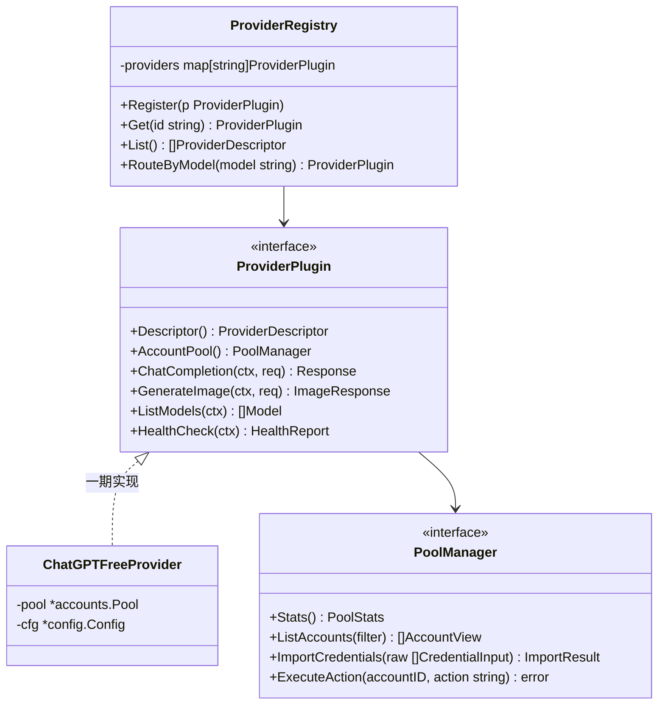

# AI-Web-Free 多供应商免费号池网关与 OpenUI 控制台设计方案

## 1. 仓库与技术栈基线

- **项目名称**：`ai-web-free`（AI Web Free Pool & Multi-Provider Reverse Proxy Hub）
- **本地路径**：`/home/luwei/workspace/github/ai-web-free`
- **远程仓库**：`https://github.com/lwpk110/ai-web-free`
- **技术栈约束**：
  - **后端**：100% 纯 Golang（Module: `ai-web-free`，基于 Gin + `bogdanfinn/tls-client` + Go `embed.FS`），不引入 Python/Node.js 等任何第三方后端运行时。
  - **前端**：原生 JavaScript (ES Modules + Web Components) + CSS Custom Properties (`tokens.css`)，遵循 **OpenUI 声明式组件规范** 与 **5 层渐进式 UI Spec (L1~L5)**，零 Node 构建依赖即可由 `go:embed` 直接打包进单一二进制文件。

---

## 2. ChatGPT 最新 API 与 `gpt-image-2.5` 深度调研结论

### 2.1 2026 最新模型矩阵现状
1. **文本与多模态主模型（实测 `/backend-api/models`）**：
   - 当前 ChatGPT 免费号池在 Web 端已全面切换至 **`gpt-5-6` 系列**（`gpt-5-6`、`gpt-5.6-terra-wm`、`gpt-5.6-luna-wm`、`gpt-5-6-mini`、`gpt-5-6-t-mini`）与 **`gpt-6` 系列**（`gpt-6`、`gpt-6-mini`、`gpt-6-t-mini`）。
2. **图像生成模型（`gpt-image-2` → `gpt-image-2.5` → `gpt-image-2.6`）**：
   - OpenAI 官方图像模型已迭代至 **`gpt-image-2.5`** 与 **`gpt-image-2.6`**，其中 `gpt-image-2.5` 拆分为两个核心性能档位：
     - **`gpt-image-2.5-sunburst`**：高细节、强构图遵循、多参考图一致性（Reference-photo consistency）与高精度局部结构编辑。
     - **`gpt-image-2.5-flare`**：面向日常高频生图的低延迟极速档位。
   - **Web 逆向接口工作机制**：
     - 在 ChatGPT Web 端（`/backend-api/f/conversation/prepare` + `/backend-api/f/conversation`），生图通过注入 `"system_hints": ["picture_v2"]` 触发内置 `gpt-image` 引擎（实测生成 PNG 的 C2PA 元数据 `softwareAgent` 为 `ChatGPT / gpt-image`）。

### 2.2 原版 Aurora 对 `image 2.5` 的支持现状与改造点
- **已支持部分**：
  - 在 `internal/chatgpt/images.go:386` 的 `imageModelSlug(model)` 中，代码判断 `strings.HasPrefix(model, "gpt-image")` 时会统一转换为 `"auto"` 并携带 `picture_v2` hint。因此直接传 `model: "gpt-image-2.5"` 已可调通。
- **原版缺失与本次定制补齐项**：
  1. **档位与参数未透传**：原版 `GeneratePictureConversationImages` 硬编码了 `"thinking_effort": "standard"`，且丢弃了 `ImageGenerationRequest` 的 `Size`（`1024x1024` / `1792x1024` / `1024x1792`）、`Quality`（`standard` / `hd` / `high`）。定制版将根据 `gpt-image-2.5-sunburst`（映射 `thinking_effort: "high"` + 尺寸/画质约束注入）与 `gpt-image-2.5-flare`（映射 `thinking_effort: "minimal"` / `"standard"`）做精细化映射。
  2. **`/v1/models` 模型列表补齐**：原版 `internal/handler/models_handler.go` 仅返回 `/backend-api/models` 的对话模型，未暴露 `gpt-image-2`、`gpt-image-2.5`、`gpt-image-2.5-sunburst`、`gpt-image-2.5-flare`、`gpt-image-2.6`、`dall-e-3`，导致下游客户端拉取模型列表时看不到生图模型。
  3. **多参考图与局部编辑体验**：原版 `GeneratePictureConversationImagesWithReferences` 已支持多张 `ImageEditReference`（挂载 `image_asset_pointer`），前端需提供多参考图上传与局部涂抹引导（Markup-guided edits）。

---

## 3. 多供应商插件机制设计（纯 Go `Provider` 架构）

为满足**“先实现 ChatGPT 免费号池管理，后续再堆其他供应商（Claude / Gemini / Grok / DeepSeek Web 等）”**的需求，在 Go 后端引入统一插件抽象层 `internal/provider`：



### 3.1 核心接口定义（`internal/provider/plugin.go`）
- **`ProviderDescriptor`**：描述供应商元信息（`id: "chatgpt"`, `name: "ChatGPT Web"`, `supported_account_types: ["free", "noauth", "puid"]`, `capabilities: [...]`, `credential_formats: ["access_token", "session_token", "refresh_token", "kami_2fa"]`）。
- **`PoolManager`**：标准化号池生命周期接口（统计、列表分页、批量导入、单号启停/测活/刷新/删除、持久化落盘）。
- **前端动态渲染契约**：前端通过 `GET /admin/api/providers` 获取已注册供应商插件列表及其 `ProviderDescriptor`，根据描述符动态渲染侧边栏供应商切换器与号池表单，后续新增供应商无需重写前端框架。

---

## 4. 基于 OpenUI 规范的 UI 5 层渐进式规格 (L1 ~ L5)

### L1：全局概览（页面与路由映射）

采用单页应用 Hash 路由，顶层包含 **供应商切换器（Provider Switcher，一期激活 `ChatGPT`，预留 `+ Add Provider` 插件槽位）** 与 4 个核心页面：

| 页面 ID (`data-page`) | 路由 | 页面名称 | 一期核心功能 |
| :--- | :--- | :--- | :--- |
| `pool-manager` | `#/pools` | **🔋 免费号池中心 (默认首页)** | 免费号 (`free`) / 免登 UUID (`noauth`) / Plus (`puid`) 状态大盘；批量导入 Token / Session / RefreshToken；单号测活、续期、启停、剔除；号池自动巡检配置 |
| `image-studio` | `#/image` | **🎨 Image 2.5 创作工坊** | 支持 `gpt-image-2.5` (`sunburst` / `flare`)、`gpt-image-2.6`、`dall-e-3`；支持文生图、多参考图合拍 (`Edits`)、图生图变体 (`Variations`)、SSE 实时流式生成进度 |
| `chat-playground` | `#/chat` | **💬 多模态对话与测试台** | 支持 `gpt-5-6` / `gpt-6` 对话测试、指定池内某个具体账号单独测活提问、文件上传问答、TTS/STT 调试 |
| `gateway-settings` | `#/settings` | **🔌 供应商插件与网关设置** | 供应商插件启用状态、代理池 (`proxies.txt`) 管理、对外 API Key 鉴权与调用日志流 |

---

### L2：页面布局（App Shell 骨架）

```text
+-----------------------------------------------------------------------------------+
| Topbar (56px): [Logo: Aurora Hub] | [Provider: 🟢 ChatGPT Web ▼] | [Active: 10/10] |
+------------------+----------------------------------------------------------------+
| Sidebar (220px)  | Main Viewport (calc(100vw - 220px))                            |
|                  | +------------------------------------------------------------+ |
| [🔋 免费号池中心] | | KPI Stat Cards (4 Columns):                                | |
| [🎨 Image 2.5]   | | [总账号: 10] [正常 Active: 10] [限流冷却: 0] [过期/异常: 0] | |
| [💬 多模态对话]   | +------------------------------------------------------------+ |
| [🔌 插件与网关]   | | Toolbar: [🔍 搜索] [状态筛选▼] [类型: Free▼] [+ 批量导入号池]| |
|                  | +------------------------------------------------------------+ |
| ---------------- | | Data Table (<ui-account-table>):                           | |
| 已加载插件:       | | ID | AccountID | 类型 | 状态徽章 | 代理 | Token过期时间 | 操作 | |
| ● chatgpt (v1)   | +------------------------------------------------------------+ |
| ○ claude (预留)   |                                                                |
+------------------+----------------------------------------------------------------+
```

---

### L3：OpenUI 组件结构与语义属性契约

所有自定义组件采用原生 Web Components / 语义化 DOM，通过 `data-part` 与 `data-state` 暴露状态：

1. **号池统计卡片 (`<section data-component="stat-grid">`)**
   - 包含 `total`、`active`、`rate_limited`、`expired_or_banned` 四组指标及免费 UUID 自动补充池状态。
2. **账号数据行 (`<tr data-component="account-row" data-status="active|rate_limited|expired|disabled|banned">`)**
   - **展示字段**：
     - `id`：内部短 ID
     - `chatgpt_account_id`：JWT 解析出的唯一账号标识（用于去重核验）
     - `type`：`free`（主管理对象）/ `noauth` / `puid`
     - `status`：6 态语义徽章
     - `token_exp`：从 JWT `exp` 解析的剩余有效天数（如 `剩余 11 天`）
     - `has_refresh`：是否具备 `session_token` / `refresh_token` 自动续期能力
     - `proxy`：绑定的独立出口代理
   - **行级操作**：`[⚡ 测活]`、`[🔄 续期]`、`[⏸ 停用/启用]`、`[🗑 删除]`
3. **批量导入抽屉 (`<dialog data-component="import-modal" data-state="open|closed">`)**
   - 支持三种导入模式切换（`data-tab`）：
     - `access_tokens`：一行一个 JWT `eyJ...`（即时解析 `exp` 与 `chatgpt_account_id` 去重入池并同步写入 `access_tokens.txt`）
     - `session_or_refresh`：导入 `session_token` 或 `refresh_token`，由 Go 后端直接调用 `/auth/session` 或 `/auth/refresh` 换取 Access Token
     - `free_noauth`：一键调整免登 UUID 号池容量

---

### L4：交互行为与新增 Go 后端接口契约

在 `internal/handler/` 下新增 `admin_handler.go`，所有接口挂载在 `/admin/api/v1` 下：

| 方法 | 路径 | 说明 |
| :--- | :--- | :--- |
| `GET` | `/admin/api/v1/providers` | 获取已注册的供应商插件列表及当前默认供应商 |
| `GET` | `/admin/api/v1/providers/:provider/stats` | 获取指定供应商号池统计（总数、各状态数、各类型数、代理数） |
| `GET` | `/admin/api/v1/providers/:provider/accounts` | 获取账号池详细列表（含 JWT 过期时间解析、脱敏 Token、状态、代理） |
| `POST` | `/admin/api/v1/providers/:provider/accounts/import` | 批量导入 Token（支持 `access_token` / `refresh_token` / `session_token`），自动去重并持久化到 `access_tokens.txt` |
| `POST` | `/admin/api/v1/providers/:provider/accounts/:id/action` | 执行单账号动作：`probe`（真实发起轻量 `/backend-api/models` 测活）、`refresh`（续期）、`enable`、`disable`、`delete` |
| `POST` | `/admin/api/v1/providers/:provider/pool/reload` | 从磁盘文件热重载号池与代理池 |

---

### L5：设计 Token 规范 (`web/styles/tokens.css`)

```css
:root, [data-theme="dark"] {
  --ui-bg-canvas: #090d16;
  --ui-bg-surface: #111827;
  --ui-bg-elevated: #1e293b;
  --ui-bg-glass: rgba(17, 24, 39, 0.78);
  --ui-border: #1f2937;
  --ui-border-hover: #334155;
  --ui-text-primary: #f8fafc;
  --ui-text-secondary: #94a3b8;
  --ui-text-muted: #64748b;

  /* 品牌与强调色 */
  --ui-brand-primary: #3b82f6;
  --ui-brand-hover: #2563eb;

  /* 账号生命周期 6 态语义色 */
  --ui-status-active: #10b981;
  --ui-status-pending: #38bdf8;
  --ui-status-rate-limited: #f59e0b;
  --ui-status-expired: #f97316;
  --ui-status-disabled: #64748b;
  --ui-status-banned: #ef4444;

  /* 布局与字体 */
  --ui-radius-sm: 6px;
  --ui-radius-md: 10px;
  --ui-radius-lg: 14px;
  --ui-font-sans: "Inter", -apple-system, BlinkMacSystemFont, "Segoe UI", sans-serif;
  --ui-font-mono: "JetBrains Mono", "Fira Code", monospace;
}
```

---

## 5. 分阶段实施计划（Execution Plan）

### Phase 1：多供应商插件基座与 ChatGPT 免费号池后端接口（纯 Go）
- **Task 1.1**：在 `internal/provider/` 下定义 `ProviderPlugin` 与 `PoolManager` 接口及 `Registry` 注册中心。
- **Task 1.2**：扩展 `internal/accounts/pool.go` 与 `jwt.go`，增加 JWT `exp` / `email` 解析、线程安全的 `ListAccounts()`、`RemoveAccount()`、`SetStatus()`、单号测活与文件持久化写回能力。
- **Task 1.3**：升级 `internal/chatgpt/images.go` 与 `internal/handler/models_handler.go`，完整支持 `gpt-image-2.5`（`sunburst` / `flare`）与 `gpt-image-2.6` 模型列表暴露及参数映射。
- **Task 1.4**：实现 `internal/handler/admin_handler.go`，挂载 `/admin/api/v1/*` 接口并通过 `go test ./...` 验证。

### Phase 2：OpenUI 前端控制台开发与 `go:embed` 集成（纯 JS + CSS Tokens）
- **Task 2.1**：创建 `web/` 目录与 `embed.go`，搭建基于 OpenUI 规范的 `tokens.css`、组件库与路由容器。
- **Task 2.2**：实现 **免费号池管理视图 (`#/pools`)**：KPI 状态卡片、账号表格（支持筛选、搜索、JWT 剩余寿命显示、一键测活、停用/启用、批量导入并落盘）。
- **Task 2.3**：实现 **Image 2.5 创作工坊 (`#/image`)** 与 **多模态对话台 (`#/chat`)**：支持 `gpt-image-2.5-sunburst` / `flare` 切换、多参考图上传改图、SSE 实时进度条。

### Phase 3：构建打包、容器替换与 GitHub 推送
- **Task 3.1**：编译单一 Go 二进制并构建新 Docker 镜像，替换本地 `8088` 端口的 `aurora` 容器，挂载现有 10 个免费号池进行实测。
- **Task 3.2**：提交全部代码并推送到 `https://github.com/lwpk110/aurora`。
