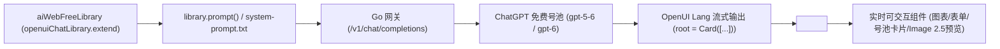

# AI-Web-Free 多供应商免费号池网关与 Thesys OpenUI (Generative UI) 设计方案

## 1. 仓库与技术栈基线

- **项目名称**：`ai-web-free`（AI Web Free Pool & Multi-Provider Reverse Proxy Hub）
- **远程仓库**：`https://github.com/lwpk110/ai-web-free`
- **技术栈架构**：
  - **后端**：100% 纯 Golang（Module: `ai-web-free`，基于 Gin + `bogdanfinn/tls-client` + Go `embed.FS`）。
  - **前端（Thesys OpenUI Generative UI）**：
    - 采用官方 **[thesysdev/openui](https://github.com/thesysdev/openui)** 框架生态：
      - `@openuidev/react-lang`：核心 OpenUI Lang 解析器、`defineComponent`、`createLibrary`、`<Renderer />` 流式渲染运行时与 `library.prompt()` 生成器。
      - `@openuidev/react-ui`：官方内置生成式 UI 组件库（`openuiChatLibrary` / `openuiLibrary`、`ThemeProvider`、内置 Charts / Tables / Forms / Cards / Tabs 组件）。
      - `@openuidev/lang-core`：无框架依赖的 OpenUI Lang 核心解析与 System Prompt 生成器。
    - 构建链路：`web/` 采用 Vite + React 19 + TypeScript，构建产物 `web/dist` 与预生成的 `web/system-prompt.txt` 通过 `//go:embed` 直接打包进单一 Go 二进制文件。

---

## 2. Thesys OpenUI (`openui-lang`) 架构设计

### 2.1 工作流概览

### 2.2 扩展组件库设计（`web/src/lib/openui-library.tsx`）

基于 `@openuidev/react-ui` 的 `openuiChatLibrary.extend(...)`，在保留全部官方内置组件（`Card`、`Stack`、`Tabs`、`Table`、`BarChart`、`LineChart`、`PieChart`、`Form`、`Input`、`Select`、`Button`、`TextContent`、`CodeBlock`、`Callout` 等）的基础上，使用 `defineComponent` + `zod/v4` 注册 3 个 `ai-web-free` 专属生成式业务组件：

1. **`PoolOverviewCard(provider, total, active, rateLimited, expired, banned, freeNoAuthCount)`**
   - 用于在对话流中实时展示多供应商免费号池健康度 KPI 大盘与一键全量测活按钮。
2. **`AccountDiagnosticTable(provider, accounts)`**
   - 在对话流中渲染可交互的账号诊断表格，每行支持直接点击触发 `[⚡ 测活]`、`[🔄 续期]`、`[⏸ 启停]`。
3. **`ImageStudioCard(prompt, model, size, quality)`**
   - 当用户要求生成或修改图片时，模型输出 `ImageStudioCard(...)`，组件直接在聊天流内调用 `/v1/images/generations`（默认 `gpt-image-2.5-sunburst` 或 `gpt-image-2.5-flare`）渲染实时进度与高清大图。

### 2.3 System Prompt 注入与对外 API 兼容性

- **内置 OpenUI Generative Workbench（默认开启 Generative UI 模式）**：
  - 前端自动通过 `aiWebFreeLibrary.prompt(aiWebFreePromptOptions)` 生成 OpenUI Lang System Prompt（或携带 `X-OpenUI-Lang: true` 请求头），并将模型流式返回的 `openui-lang` 语句实时传入 `<Renderer />`。
  - 支持一键切换为「纯文本 Markdown 模式」，满足普通文本问答调试需求。
- **对外 `/v1/chat/completions` 接口兼容**：
  - 默认情况下（未传 `X-OpenUI-Lang: true`），完全保持标准 OpenAI Chat Completions 行为，不影响任何第三方客户端。
  - 当请求头包含 `X-OpenUI-Lang: true` 且消息列表中未包含 OpenUI System Prompt 时，Go 后端自动注入内嵌的 `web/system-prompt.txt`，让外部轻量客户端也能直接获得 OpenUI Lang 流式响应。

---

## 3. 三合一前端视图架构

| 视图路由 | 视图名称 | 核心能力 |
| :--- | :--- | :--- |
| `#/chat` | **✨ OpenUI Generative Workbench** | 基于 `@openuidev/react-lang` `<Renderer />` 与 `@openuidev/react-ui` `ThemeProvider` 的生成式 UI 对话工作台；支持预置 Prompt 一键生成仪表盘、号池分析大盘、交互式表单、Image 2.5 卡片与实时 OpenUI Lang 源码检视器 |
| `#/pools` | **🔋 免费号池与多供应商中心** | 多供应商插件切换（一期激活 `ChatGPT Web`）；KPI 统计卡片；账号列表筛选/搜索；单号测活 (`probe`)、续期 (`refresh`)、启停、删除；批量导入 `access_token` / `session_token` / `refresh_token`；代理池 (`proxies.txt`) 在线配置 |
| `#/image` | **🎨 Image 2.5 创作工坊** | 支持 `gpt-image-2.5-sunburst`（高细节精绘）、`gpt-image-2.5-flare`（极速生图）、`gpt-image-2.5`、`gpt-image-2.6`、`dall-e-3`；支持文生图与多参考图合拍 (`POST /v1/images/edits`) |
